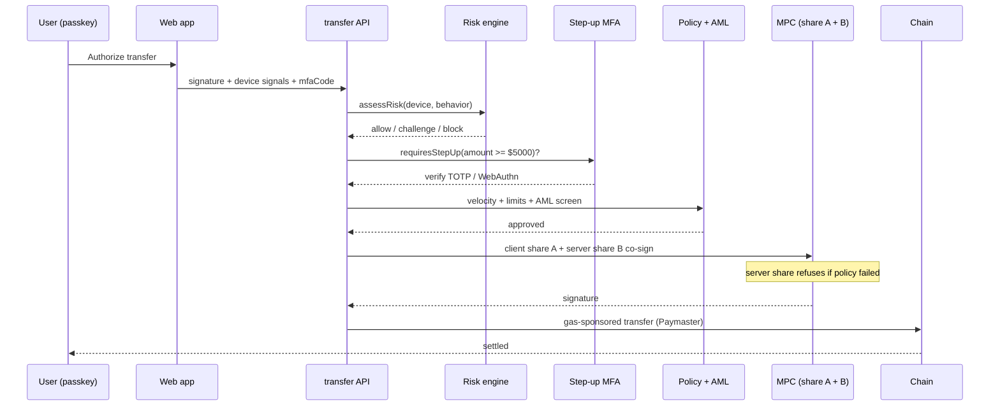
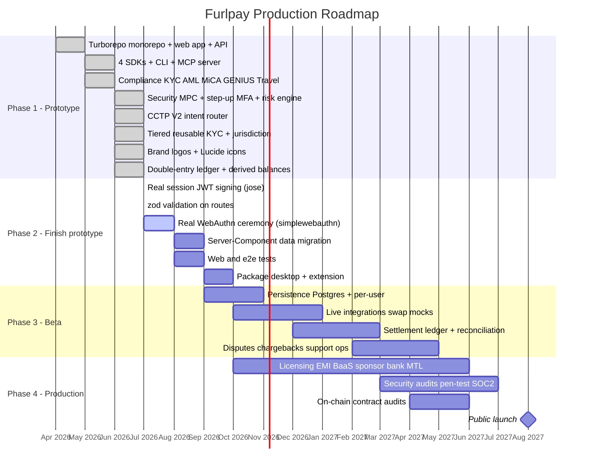

<div align="center">


# Furlpay

**The on-chain financial operating system for stablecoin payments, global travel, cards, and agentic commerce.**

[furlpay.com](https://furlpay.com) · [Docs](https://furlpay.com/docs) · [Developer platform](https://furlpay.com/developers) · [Security](SECURITY.md)

**App & tooling**


**SDKs**


**Rails**


</div>

The Stripe + Coinbase of stablecoins and fractional investing. Furlpay is a
stablecoin-first financial super-app plus a full developer ecosystem and a
programmatic compliance stack, built as a Turborepo monorepo.

Every third-party integration (Safe/MPC, Circle CCTP, Bridge, Wise, Li.Fi,
Alpaca, Marqeta, Chainalysis, Persona, Notabene) runs in mock/sandbox mode by
default, so the entire repository runs end to end with zero API keys and zero
cost.

This is an architecture reference and prototype, not a licensed financial
product. Production deployment requires custody/EMI partners, security audits,
and live KYC.

---

## Table of contents

- [Overview](#overview)
- [Architecture](#architecture)
- [Feature summary](#feature-summary)
- [Tech stack](#tech-stack)
- [Icon system](#icon-system)
- [Monorepo structure](#monorepo-structure)
- [Web application](#web-application)
- [API endpoints](#api-endpoints)
- [Developer ecosystem](#developer-ecosystem)
- [Compliance stack](#compliance-stack)
- [Security model](#security-model)
- [Getting started](#getting-started)
- [Testing and CI](#testing-and-ci)
- [Verification status](#verification-status)
- [Roadmap](#roadmap)

---

## Overview

Furlpay unifies four products into one app:

- Spend: stablecoin Visa cards (USDC/EURC) backed by a self-custodial Safe
  smart account, with a real-time policy engine and on-chain pre-authorization
  escrow.
- Bank: multi-currency accounts with local details (IBAN, routing, sort code,
  UPI) and mid-market FX off-ramps via Wise-style rails.
- Invest: fractional US stocks and ETFs (Alpaca-style order semantics).
- Build: SDKs, a CLI, embeddable UI widgets, an Account Kit, an OpenAPI spec,
  and a Model Context Protocol server for AI agents.

Underneath, a shared compliance package enforces MiCA and GENIUS stablecoin
routing, KYC and AML screening, and the FATF Travel Rule.

---

## Architecture

### System architecture


### High-value transfer flow



---

## Feature summary

Consumer application:

- Marketing landing page, passkey (WebAuthn) login and signup with KYC.
- Unified dashboard: net worth across on-chain, fiat, and equities.
- Cards: swipable carousel, freeze/unfreeze, limits, channel toggles,
  settlement currency, biometric-gated credential reveal, and an escrow
  pre-authorization center.
- Investing: portfolio value and daily P&L, holdings, dividends, and a trade
  sheet supporting dollar-notional or share quantity with market/limit orders.
- Banking: provision virtual accounts and copy local bank details.
- Bills and off-ramp: on-chain bill pay, autopay, and a Wise mid-market
  off-ramp quoter with local settlement rails.
- Profile and security center: KYC status, plan tier, biometric toggle, login
  alerts, device and session management, instant account lock, notification
  preferences, logout, and delete account.

Platform:

- Server-side SDKs in TypeScript/Node, Python, Go, and Rust, all sharing an
  identical HMAC-SHA256 webhook signature scheme.
- Command-line interface for webhook forwarding, event triggering, and log
  streaming.
- Embeddable Elements widgets and a smart-account Account Kit.
- OpenAPI 3.1 specification and a Model Context Protocol server.

---

## Tech stack

Frontend and app


Monorepo and tooling


SDKs and clients


Desktop, extension and AI


Web3 and rails


Application:

- Next.js 14 (App Router) with React 18 and TypeScript.
- Tailwind CSS design system (OLED-black theme, red accent, Inter typeface).
- Next.js Route Handlers as the serverless API layer.
- Cookie-based session gating via Next.js middleware.

Monorepo and tooling:

- Turborepo task runner with npm workspaces.
- Shared TypeScript configuration and shared domain-type packages.
- GitHub Actions CI.

Desktop and extension:

- Tauri v2 (Rust) desktop shell with OS keychain secure storage.
- Manifest V3 Chrome/Firefox browser extension.

SDK languages:

- TypeScript/Node, Python (standard library only), Go, and Rust (dependency-free
  SHA-256 and HMAC).

Integration seams (mocked, ready to swap to live clients):

- Auth and MPC: Turnkey, Dynamic.xyz.
- Smart accounts: Safe, ERC-4337, paymaster.
- Cross-chain: Circle CCTP, Li.Fi, 1inch.
- Fiat rails: Bridge, Wise, local instant-payment networks.
- Cards: Marqeta, Lithic.
- Investing: Alpaca.
- Compliance: Chainalysis, TRM, Persona, Sumsub, Notabene.

---

## Icon system

Primary icon library: Lucide. Furlpay uses Lucide as its primary UI icon set,
re-exported under semantic names in `apps/web/src/components/icons.tsx` so call
sites remain stable. The user interface contains no emoji.

Current Lucide mappings include Home, CreditCard, TrendingUp, ReceiptText,
User, Eye, Snowflake, SlidersHorizontal, Settings, Plus, ArrowUpRight,
ArrowDownLeft, ArrowLeftRight, QrCode, Lock, TriangleAlert, X, Check, and
ShieldCheck.

Planned secondary sets:

- Material Symbols for platform and system consistency where native look is
  desired.
- Phosphor for premium-weight chart and illustration icons.

Planned brand assets: official SVG logos for stablecoins (USDC, USDT, PYUSD,
EURC, DAI), chains (Ethereum, Solana, Base, Arbitrum, Polygon), wallets, and
card networks (Visa, Mastercard), to be vendored into the shared UI package and
exposed through CoinLogo and ChainLogo components. Tokens are currently rendered
as text labels.

---

## Monorepo structure

```
furlpay-monorepo/
  apps/
    web/           Next.js app and serverless API routes
    desktop/       Tauri v2 shell (Rust) with OS keychain storage
    extension/     Manifest V3 browser extension
  packages/
    ui/            Design tokens and primitives
    types/         Shared domain primitives (chains, stablecoins, regions)
    compliance/    KYC, AML, MiCA, GENIUS, FCA, Travel Rule, webhook signatures
    security/      2-of-2 MPC, RFC 6238 TOTP, step-up MFA, device/behavioral risk
    elements/      Embeddable checkout button and secure card input
    account-kit/   Safe deployment, paymaster config, escrow bindings
    cli/           Command-line interface
    typescript-config/  Shared tsconfig
  sdks/
    node/          Official TypeScript/Node SDK
    python/        Official Python SDK
    go/            Official Go SDK
    rust/          Official Rust SDK
  mcp/             Model Context Protocol server
  turbo.json       Turborepo task configuration
```

---

## Web application

Routes:

- `/` marketing landing page
- `/login` and `/signup` passkey authentication and KYC onboarding
- `/dashboard` unified net worth and quick actions
- `/cards` card management and escrow center
- `/investing` fractional stocks and ETFs
- `/banking` virtual accounts and local details
- `/bills` bill pay and off-ramp
- `/profile` profile and security center
- `/developer` developer console and API reference

Global route boundaries provide loading skeletons, an error boundary, and a
not-found page.

---

## API endpoints

Authentication and profile:

- `POST /api/auth/webauthn` passkey challenge, registration, login
- `POST /api/auth/logout` clear session
- `GET /api/profile`, `PATCH /api/profile`

Wallets and banking:

- `GET /api/wallets` Safe balances and active modules
- `POST /api/wallets/transfer` gas-sponsored transfer with signature and AML checks
- `GET /api/banking`, `POST /api/banking` provision virtual accounts

Cards:

- `GET /api/cards`, `POST /api/cards` issue card
- `POST /api/cards/settings` card controls
- `POST /api/cards/spend` policy-engine authorization
- `GET`/`POST /api/escrow` pre-authorization holds

Investing and swaps:

- `GET /api/investing/portfolio`, `POST /api/investing/order`
- `GET`/`POST /api/swaps` cross-chain swap routing

Payments and off-ramp:

- `POST /api/checkout/session` merchant checkout session
- `POST /api/offramp` fiat off-ramp quote and execution

Security and compliance:

- `GET`/`POST /api/security/mfa` TOTP MFA status, enroll, verify, disable
- `GET`/`POST /api/compliance` address screening and inbound routing
- `POST /api/compliance/kyc` identity verification
- `GET`/`POST /api/compliance/tier` tiered-KYC limits and gating
- `POST /api/compliance/credential` issue / verify reusable KYC credential
- `GET /api/compliance/jurisdiction` per-region regime, routing, and rail
- `POST /api/compliance/travel-rule` FATF Travel Rule payload

Webhooks (signature-verified, idempotent):

- `POST /api/webhooks/bridge`
- `POST /api/webhooks/wise`
- `POST /api/webhooks/marqeta`

The complete OpenAPI 3.1 specification is served at `/openapi.json`.

---

## Developer ecosystem

Command-line interface (`packages/cli`):

```
furlpay login --key sk_sandbox_...
furlpay listen --forward-to localhost:3000/api/webhooks
furlpay trigger card.transaction.authorized
furlpay logs --tail
```

Server-side SDKs share the same webhook verification contract:

```ts
import { Furlpay } from "@furlpay/furlpay-node";
const event = Furlpay.webhooks.constructEvent(
  req.body,
  req.headers["furlpay-signature"],
  process.env.FURLPAY_ENDPOINT_SECRET
);
```

Elements provide FurlpayCheckoutButton and FurlpaySecureCardInput. The Account
Kit provides Safe deployment from passkeys, paymaster configuration, and escrow
bindings.

Model Context Protocol server (`mcp/server.js`) exposes tools for AI coding
assistants: get_wallet_balances, quote_swap, place_investment_order,
screen_wallet_risk, and verify_identity.

---

## Compliance stack

The `@furlpay/compliance` package provides:

- KYC identity verification (Persona and Sumsub seam)
- AML wallet risk screening (Chainalysis and TRM seam)
- MiCA stablecoin routing (auto-swap non-compliant tokens for EEA users)
- GENIUS Act allow-list for US users
- FCA financial promotions geofence for UK users
- FATF Travel Rule payloads above the reporting threshold
- Webhook signature signing and verification (HMAC-SHA256)

---

## Security model

Defense in depth. Full details in [SECURITY.md](./SECURITY.md).

- Passkey (WebAuthn) authentication mints an HttpOnly session cookie; Next.js
  middleware gates pages and protected APIs (public allowlist: auth, webhooks,
  checkout, signup KYC).
- 2-of-2 MPC signing model (`@furlpay/security`): client share bound to the
  passkey, server share in an HSM; the server share refuses to co-sign unless
  the off-chain policy gate approves (anti-Gnosis-Pay design).
- Step-up MFA for high-value or sensitive actions: transfers >= USD 5,000 and
  card/settlement/payee changes require a second factor. FIDO2 hardware keys
  preferred; RFC 6238 TOTP as backup (`/api/security/mfa`, secret never
  returned to the client).
- Real-time device and behavioral risk engine (Sardine seam): automation and
  remote-access tools hard-block; emulator/VPN/new-device raise a challenge.
- Outbound transfers require a valid signature and pass AML screening before the
  paymaster co-signs; card credential reveal requires biometric re-auth.
- Webhooks are signature-verified (HMAC-SHA256) and idempotent by event id.
- API responses project only required fields; TOTP secret and device data are
  never exposed through read endpoints.

---

## Getting started

Requirements: Node.js 20 or later. Optional: Go 1.21+, Rust toolchain, and
Python 3.9+ to build the respective SDKs; Tauri toolchain for the desktop app.

```
npm install
npm run dev
```

Then open http://localhost:3000. To run only the web app:

```
npm run web
```

Copy `apps/web/.env.example` to configure live provider keys. All services
default to mock mode.

---

## Testing and CI

```
npm test
```

- Node SDK: six webhook and client tests via the Node test runner.
- Compliance package: ten tests covering webhook signatures, MiCA and GENIUS
  routing, AML screening, Travel Rule, FCA promotions, and KYC.
- Rust SDK: three tests including a SHA-256 known-answer vector.

GitHub Actions runs web lint and build, Node SDK build and tests, compliance
tests, Go build, Rust tests, and a Python signature check.

---

## Verification status

Verified locally:

- Root Turborepo build passes for all buildable packages.
- Web application lints clean and builds.
- Node SDK, compliance package, and Rust SDK tests pass.
- Go SDK builds; Python SDK signature round-trip verified.
- MCP server responds to JSON-RPC initialize and tools/list.
- CLI signs events that verify server-side; tampered signatures are rejected.
- Authentication, signature verification, and endpoint behavior verified end to
  end.

---

## Roadmap

### Production roadmap



### Status detail

Done (Phase 1):

- Official brand-logo components (CoinLogo, ChainLogo, CardNetworkLogo) wired
  into the dashboard and cards.
- Circle CCTP V2 adapter and intent-based cross-chain router (`/api/intents`):
  native USDC via CCTP V2 burn-and-mint, everything else via Li.Fi.
- Tiered, risk-based KYC with reusable "verify once, use everywhere"
  credentials (`/api/compliance/tier`, `/api/compliance/credential`).
- Jurisdiction resolver for per-region stablecoin, promotion, and rail routing
  (`/api/compliance/jurisdiction`).
- Defense-in-depth security: 2-of-2 MPC, step-up MFA (TOTP), device risk engine.

Done (Phase 2 so far):

- Real signed JWT sessions via `jose` (HS256), verified in edge middleware;
  tampered/expired tokens rejected.
- zod request validation on core money routes (transfer, intents, checkout,
  banking) with structured 400s.
- Real WebAuthn ceremony via `@simplewebauthn/server` (`/api/auth/passkey/*`):
  registration + authentication options and verification (origin, challenge,
  counter). Full assertion requires a browser authenticator.
- Double-entry ledger (`@furlpay/ledger`): immutable balanced postings, derived
  balances, reversals; wired into transfers, orders, and off-ramps; exposed at
  `/api/ledger` with a trial-balance invariant.

Next (Phase 2):

- Full Server-Component data-fetch migration; browser-driven WebAuthn e2e.
- Wallet, exchange and market-data brand logos; secondary Material Symbols set.
- Web / e2e tests; desktop and extension packaging and distribution.

Later (Phase 3-4): persistence, live integrations, settlement ledger,
licensing and partners, and security/compliance audits before any launch.
