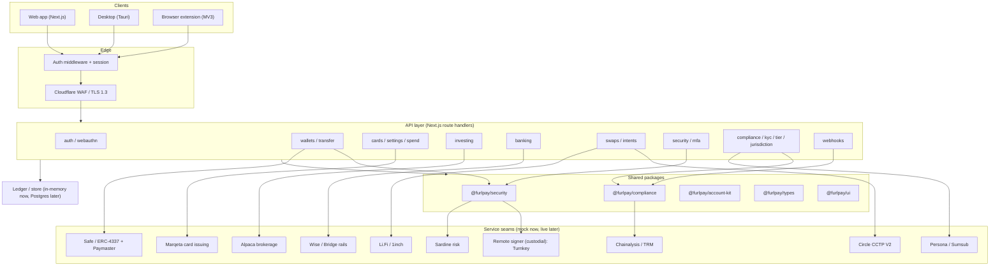
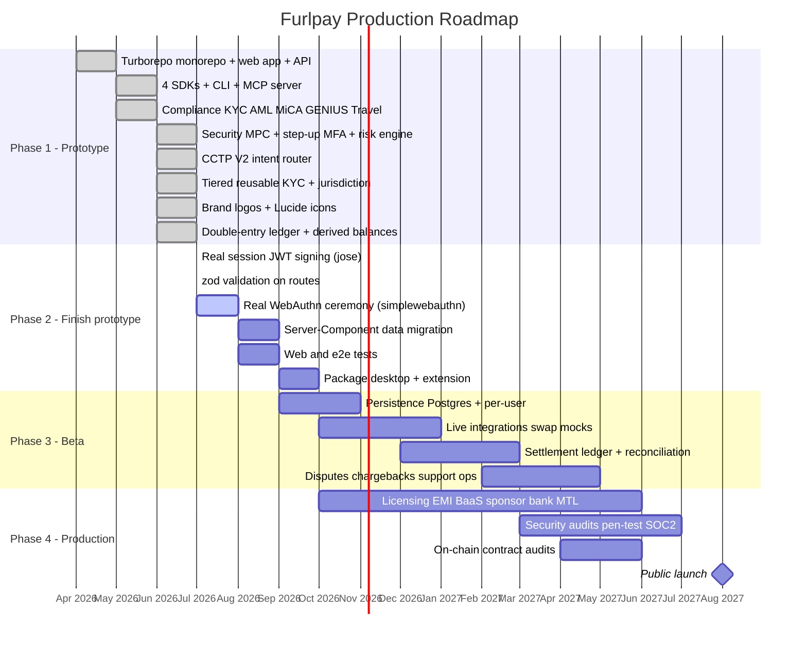

<div align="center">


# Furlpay

**Stablecoin payment infrastructure, merchant checkout and agent payment tooling.**

[furlpay.com](https://furlpay.com) · [Docs](https://furlpay.com/docs) · [Developer platform](https://furlpay.com/developers) · [Security](SECURITY.md)

**App & tooling**


**SDKs**


**Rails**


</div>

On-chain financial infrastructure for stablecoin payments: a web client, a
developer ecosystem and a programmatic compliance stack, built as a Turborepo
monorepo. Fractional investing, card issuing and local accounts are in
development — see the per-integration breakdown below, which is the honest
version of what "built" means here.

Most third-party integrations run in mock/sandbox mode by default, so the
repository runs end to end with zero API keys and zero cost. Be precise about
what that means per integration, because "an adapter exists" and "the
integration exists" are different claims:

- **Real when credentialed:** Turnkey (remote signing), Coinbase CDP (hosted
  fiat on-ramp), LI.FI (swap routing), Stripe, Persona, Sumsub,
  QuickNode/Alchemy deposit webhooks.
- **Real, credential-free:** the x402 / EIP-3009 path — the one rail proven to
  move money end to end in a local environment — and Circle CCTP V2, whose
  burn/mint calldata and per-corridor fees both come from public Circle
  endpoints. Note the consequence for offline work: CCTP quoting reaches
  `iris-api.circle.com` for the real fee and **refuses to quote** if it cannot,
  rather than falling back to an assumed rate. No key, but not airgapped.

  Read "credential-free" as a property of the CODE, not of the deployment.
  `furlpay.com` serves a real 402 challenge, but it has no production
  facilitator signer, fee payer or Arbitrum RPC endpoint configured, so
  `/api/rails` reports x402, MPP and gasless transfers as `NOT_CONFIGURED` and
  nothing settles there. `apps/web/src/lib/productionStatus.ts` is the
  registry the public site derives its status wording from, and
  `apps/web/scripts/check-claims.mjs` fails the build if a page claims more
  than that registry does.
- **Interface only, no provider:** Travel Rule (`travelRule.ts` transmits
  nothing), KMS backends other than Turnkey, card issuing.
- **Not present at all:** Rain, and every Indian fiat rail (UPI / IMPS / NEFT /
  RTGS). There is no INR collection or payout anywhere in this repository. The
  only UPI code is `native-app/lib/upi.ts`, a deep-link handoff to the user's
  own PSP app in which FurlPay never touches the money.
- **Deleted 6 Sep 2026:** the Bridge, Wise and Marqeta webhook endpoints. They
  verified FurlPay's own outbound HMAC envelope rather than each provider's
  scheme, so they could never have accepted a real event from any of the three,
  and they shared one secret.

**Circle Arc** (mainnet 2026-09-16) is typed and verified but deliberately not
advertised. Arc is an EVM L1 whose native gas asset is USDC, which removes the
ETH float from the settlement path — but it also carries the one decimal hazard
in this codebase: Arc exposes a single balance through two interfaces, native at
18 decimals and ERC-20 at 6. Measured on mainnet, an account reading
`57628035984085784575` natively reads `57628035` through ERC-20 — the same
money, with the sub-cent remainder invisible to the second view. `USDC.arc` is
therefore ONE asset at 18 decimals, and `lib/chains/arc.ts` owns the conversion.
The chain ids, USDC contract and EIP-712 domain separator were each read from
the live RPCs rather than copied from documentation. Arc stays out of the
facilitator's advertised `NETWORKS` until a settlement has actually been driven
on it; a test pins that gate shut.

This is an architecture reference and prototype, not a licensed financial
product. Production deployment requires custody/EMI partners, security audits,
and live KYC.

---

## Table of contents

- [Overview](#overview)
- [Architecture](#architecture)
- [Feature summary](#feature-summary)
- [Tech stack](#tech-stack)
- [Icon system](#icon-system)
- [Monorepo structure](#monorepo-structure)
- [Web application](#web-application)
- [API endpoints](#api-endpoints)
- [Developer ecosystem](#developer-ecosystem)
- [Compliance stack](#compliance-stack)
- [Security model](#security-model)
- [Getting started](#getting-started)
- [Testing and CI](#testing-and-ci)
- [Verification status](#verification-status)
- [Roadmap](#roadmap)

---

## Overview

The repository contains code for four product areas. Code existing here is not
the same as a service being offered; the status table below says which is which.

- Pay: USDC payment APIs, merchant payment links and hosted checkout,
  contractor payroll, cross-chain transfers and agent payment protocols.
- Build: SDKs, a CLI, embeddable UI widgets, an Account Kit, an OpenAPI spec,
  and a Model Context Protocol server for AI agents.
- Spend and Bank (not offered): card and bank-account code paths exist behind
  flags that cannot be enabled, because no card issuer or banking partner is
  contracted.
- Invest (not enabled): order code exists; orders are not routed to a brokerage.

A shared compliance package provides sanctions screening, jurisdiction rules
and travel-rule payload computation. These are software controls, not a
licence.

### Production status (checked 11 October 2026)

The source of truth is `apps/web/src/lib/productionStatus.ts`; the public
version is [furlpay.com/docs](https://furlpay.com/docs). A capability is
"production verified" only when a production response was observed.

| Capability | Status |
|---|---|
| Web platform, passkey sign-in, docs, SDKs | Production verified |
| Payment fee estimates, client-signed payment and bridge construction | Production verified |
| Market data, hotel discovery map | Production verified |
| x402 challenges, rail status (`/api/rails`) | Blocked by external dependency: the key-value store is over its plan limit, so these answer 503 |
| x402 / MPP settlement, gasless transfers, agent payment execution | Implemented, disabled: no production signer or relayer |
| Merchant payment links, hosted checkout, refunds, reconciliation | Implemented, not production verified: needs migrations 0040–0047 and a custody provider for collection addresses |
| Sui and Arc collection | Implemented, not production verified |
| Contractor payroll | Blocked by external dependency: no router contract deployed |
| Settlement workspace, business onboarding, compliance cases | Implemented, not production verified |
| Circle user-controlled wallets | Implemented, disabled: no Circle Wallets credentials in production |
| Telegram Mini App | Partially implemented in production: the page loads, sign-in answers 503 until the key-value store is restored |
| Travel booking, stock and ETF orders | Implemented, disabled |
| Fiat on-ramp and off-ramp | Blocked by external dependency: no provider contract is live |
| Card issuing, bank accounts, credit, bill pay, rewards | Not implemented |
| Mobile and desktop apps | Implemented, not distributed |

Deployment setup (credentials, flags, migrations, scheduled jobs) is documented
at [furlpay.com/docs/architecture/configuration](https://furlpay.com/docs/architecture/configuration).

---

## Architecture

### System architecture



### High-value transfer flow

```mermaid
sequenceDiagram
    participant U as User (passkey)
    participant W as Web app
    participant API as transfer API
    participant R as Risk engine
    participant S as Step-up MFA
    participant P as Policy + AML
    participant M as Remote signer (Turnkey, custodial)
    participant C as Chain

    U->>W: Authorize transfer
    W->>API: signature + device signals + mfaCode
    API->>R: assessRisk(device, behavior)
    R-->>API: allow / challenge / block
    API->>S: requiresStepUp(amount >= $5000)?
    S-->>API: verify TOTP / WebAuthn
    API->>P: velocity + limits + AML screen
    P-->>API: approved
    API->>M: digest + spend context (policy checked client-side first)
    Note over M: route refuses out-of-policy; enclave refuses again
    M-->>API: signature
    API->>C: gas-sponsored transfer (Paymaster)
    C-->>U: settled
```

---

## Feature summary

Consumer application:

- Marketing landing page, passkey (WebAuthn) login and signup with KYC.
- Unified dashboard: net worth across on-chain, fiat, and equities.
- Cards: swipable carousel, freeze/unfreeze, limits, channel toggles,
  settlement currency, biometric-gated credential reveal, and an escrow
  pre-authorization center.
- Investing: portfolio value and daily P&L, holdings, dividends, and a trade
  sheet supporting dollar-notional or share quantity with market/limit orders.
- Banking: provision virtual accounts and copy local bank details.
- Bills and off-ramp: on-chain bill pay, autopay, and a Wise mid-market
  off-ramp quoter with local settlement rails.
- Profile and security center: KYC status, plan tier, biometric toggle, login
  alerts, device and session management, instant account lock, notification
  preferences, logout, and delete account.

Platform:

- Server-side SDKs in TypeScript/Node, Python, Go, and Rust, all sharing an
  identical HMAC-SHA256 webhook signature scheme.
- Command-line interface for webhook forwarding, event triggering, and log
  streaming.
- Embeddable Elements widgets and a smart-account Account Kit.
- OpenAPI 3.1 specification and a Model Context Protocol server.

---

## Tech stack

Frontend and app


Monorepo and tooling


SDKs and clients


Desktop, extension and AI


Web3 and rails


Application:

- Next.js 14 (App Router) with React 18 and TypeScript.
- Tailwind CSS design system (OLED-black theme, red accent, Inter typeface).
- Next.js Route Handlers as the serverless API layer.
- Cookie-based session gating via Next.js middleware.

Monorepo and tooling:

- Turborepo task runner with npm workspaces.
- Shared TypeScript configuration and shared domain-type packages.
- GitHub Actions CI.

Desktop and extension:

- Tauri v2 (Rust) desktop shell with OS keychain secure storage.
- Manifest V3 Chrome/Firefox browser extension.

SDK languages:

- TypeScript/Node, Python (standard library only), Go, and Rust (dependency-free
  SHA-256 and HMAC).

Integration seams (mocked, ready to swap to live clients):

- Auth and MPC: Turnkey, Dynamic.xyz.
- Smart accounts: Safe, ERC-4337, paymaster.
- Cross-chain: Circle CCTP, Li.Fi, 1inch.
- Fiat rails: Bridge, Wise, local instant-payment networks.
- Cards: Marqeta, Lithic.
- Investing: Alpaca.
- Compliance: Chainalysis, TRM, Persona, Sumsub, Notabene.

---

## Icon system

Primary icon library: Lucide. Furlpay uses Lucide as its primary UI icon set,
re-exported under semantic names in `apps/web/src/components/icons.tsx` so call
sites remain stable. The user interface contains no emoji.

Current Lucide mappings include Home, CreditCard, TrendingUp, ReceiptText,
User, Eye, Snowflake, SlidersHorizontal, Settings, Plus, ArrowUpRight,
ArrowDownLeft, ArrowLeftRight, QrCode, Lock, TriangleAlert, X, Check, and
ShieldCheck.

Planned secondary sets:

- Material Symbols for platform and system consistency where native look is
  desired.
- Phosphor for premium-weight chart and illustration icons.

Planned brand assets: official SVG logos for stablecoins (USDC, USDT, PYUSD,
EURC, DAI), chains (Ethereum, Solana, Base, Arbitrum, Polygon), wallets, and
card networks (Visa, Mastercard), to be vendored into the shared UI package and
exposed through CoinLogo and ChainLogo components. Tokens are currently rendered
as text labels.

---

## Monorepo structure

```
furlpay-monorepo/
  apps/
    web/           Next.js app and serverless API routes
    desktop/       Tauri v2 shell (Rust) with OS keychain storage
    extension/     Manifest V3 browser extension
  packages/
    ui/            Design tokens and primitives
    types/         Shared domain primitives (chains, stablecoins, regions)
    compliance/    KYC, AML, MiCA, GENIUS, FCA, Travel Rule, webhook signatures
    security/      signing policy gates, RFC 6238 TOTP, step-up MFA, device risk
    elements/      Embeddable checkout button and secure card input
    account-kit/   Safe deployment, paymaster config, escrow bindings
    cli/           Command-line interface
    typescript-config/  Shared tsconfig
  sdks/
    node/          Official TypeScript/Node SDK
    python/        Official Python SDK
    go/            Official Go SDK
    rust/          Official Rust SDK
  mcp/             Model Context Protocol server
  turbo.json       Turborepo task configuration
```

---

## Web application

Routes:

- `/` marketing landing page
- `/login` and `/signup` passkey authentication and KYC onboarding
- `/dashboard` unified net worth and quick actions
- `/cards` card management and escrow center
- `/investing` fractional stocks and ETFs
- `/banking` virtual accounts and local details
- `/bills` bill pay and off-ramp
- `/profile` profile and security center
- `/developer` developer console and API reference
- `/support` support centre; `/support/new` raise a ticket, `/support/tickets`
  your tickets, `/support/<id>` the conversation

Note the detail route is `/support/<id>`, not `/support/tickets/<id>`. Both
`/support/new` and `/support/tickets` are static segments so the dynamic `<id>`
segment cannot absorb them — a earlier version lacked those segments and
`/support/new` resolved as a ticket whose id was the literal string "new",
producing "Could not load this ticket" on the create page.

Global route boundaries provide loading skeletons, an error boundary, and a
not-found page.

---

## API endpoints

Authentication and profile:

- `POST /api/auth/webauthn` passkey challenge, registration, login
- `POST /api/auth/logout` clear session
- `GET /api/profile`, `PATCH /api/profile`

Wallets and banking:

- `GET /api/wallets` Safe balances and active modules
- `POST /api/wallets/transfer` gas-sponsored transfer with signature and AML checks
- `GET /api/banking`, `POST /api/banking` provision virtual accounts

Cards:

- `GET /api/cards`, `POST /api/cards` issue card
- `POST /api/cards/settings` card controls
- `POST /api/cards/spend` policy-engine authorization
- `GET`/`POST /api/escrow` pre-authorization holds

Support:

- `GET`/`POST /api/support/tickets` list or raise a ticket. The owner is taken
  from the session; a `userId` in the body is ignored.
- `GET`/`PATCH /api/support/tickets/<id>` ticket detail and status.
  Ownership is enforced at the query layer and a non-owner gets **404, not 403**,
  so ticket ids cannot be used as an existence oracle.
- `GET`/`POST /api/support/tickets/<id>/messages` conversation. The author is
  derived server-side, so a client cannot post as Support.
- `POST /api/support/ask` grounded help-centre retrieval. Public, IP
  rate-limited, secret-redacted. It takes no ticket id and has no ticket-reading
  tool, so it has no private data in reach.

Investing and swaps:

- `GET /api/investing/portfolio`, `POST /api/investing/order`
- `GET`/`POST /api/swaps` cross-chain swap routing

Payments and off-ramp:

- `POST /api/checkout/session` merchant checkout session
- `POST /api/offramp` fiat off-ramp quote and execution

Security and compliance:

- `GET`/`POST /api/security/mfa` TOTP MFA status, enroll, verify, disable
- `GET`/`POST /api/compliance` address screening and inbound routing
- `POST /api/compliance/kyc` identity verification
- `GET`/`POST /api/compliance/tier` tiered-KYC limits and gating
- `POST /api/compliance/credential` issue / verify reusable KYC credential
- `GET /api/compliance/jurisdiction` per-region regime, routing, and rail
- `POST /api/compliance/travel-rule` FATF Travel Rule payload

Inbound webhooks (signature-verified against the SENDING provider's own
scheme, idempotent, fail closed when the secret is unset):

- `POST /api/webhooks/stripe` — `stripe-signature`
- `POST /api/webhooks/persona` — `persona-signature`
- `POST /api/webhooks/sumsub` — `x-payload-digest` + `x-payload-digest-alg`
- `POST /api/webhooks/deposit-detect` — QuickNode / Alchemy HMAC + timestamp
- `POST /api/webhooks/complyadvantage` — provider signature
- `POST /api/webhooks/card-auth` — `FURLPAY_CARDAUTH_ENDPOINT_SECRET`

Endpoints named for Bridge, Wise and Marqeta were **deleted**. They verified
FurlPay's *own* outbound HMAC envelope rather than each provider's scheme, so
they could never have accepted a real event from any of those three — and they
shared one secret, which meant a single leak forged all of them. There is no
contract with any of the three; the honest route count is zero.

The complete OpenAPI 3.1 specification is served at `/openapi.json`.

---

## Developer ecosystem

Command-line interface (`packages/cli`):

```
furlpay login --key sk_sandbox_...
furlpay listen --forward-to localhost:3000/api/webhooks
furlpay trigger card.transaction.authorized
furlpay logs --tail
```

Server-side SDKs share the same webhook verification contract:

```ts
import { Furlpay } from "@furlpay/furlpay-node";
const event = Furlpay.webhooks.constructEvent(
  req.body,
  req.headers["furlpay-signature"],
  process.env.FURLPAY_ENDPOINT_SECRET
);
```

Elements provide FurlpayCheckoutButton and FurlpaySecureCardInput. The Account
Kit provides Safe deployment from passkeys, paymaster configuration, and escrow
bindings.

Model Context Protocol server (`mcp/server.js`) exposes tools for AI coding
assistants: get_wallet_balances, quote_swap, place_investment_order,
screen_wallet_risk, and verify_identity.

---

## Compliance stack

The `@furlpay/compliance` package provides:

- KYC identity verification (Persona and Sumsub seam)
- AML wallet risk screening (Chainalysis and TRM seam)
- MiCA stablecoin routing (auto-swap non-compliant tokens for EEA users)
- GENIUS Act allow-list for US users
- FCA financial promotions geofence for UK users
- FATF Travel Rule payloads above the reporting threshold
- Webhook signature signing and verification (HMAC-SHA256)

---

## Security model

Defense in depth. Full details in [SECURITY.md](./SECURITY.md).

- Passkey (WebAuthn) authentication mints an HttpOnly session cookie; Next.js
  middleware gates pages and protected APIs (public allowlist: auth, webhooks,
  checkout, signup KYC).
- **Two signers, and they are not equivalent — read this before trusting the
  word "MPC" anywhere else in this file.**
  - **On-device key** (`native-app/lib/signing/deviceKeySigner.ts`): a BIP-39
    seed in biometric-gated SecureStore, never transmitted. Genuinely
    self-custodial. The phone both holds the key and draws the confirmation, so
    `trustedDisplay` is `false` — that is what a hardware signer would fix.
  - **Remote signer** (Turnkey, via `/api/mpc/sign`): **CUSTODIAL.** Turnkey
    signs a digest inside an enclave and returns a COMPLETE signature. The
    device contributes no share; it verifies that the returned signature
    recovers to the expected address, which is a correct check and is not
    participation in a threshold scheme. Anything holding the Turnkey
    organisation credential can move the funds behind any wallet in that
    organisation. Calling this "2-of-2" overstates it, and the overstatement is
    not cosmetic: custodial VDA custody changes FIU-IND scope, insurance and
    balance-sheet treatment.
  - What IS 2-of-2 is the POLICY path: the client refuses to request an
    out-of-policy signature, `/api/mpc/sign` refuses to forward one, and
    Turnkey's own enclave policy refuses to produce one. Three independent
    gates, each of which can fail without opening the others.
- Step-up MFA for high-value or sensitive actions: transfers >= USD 5,000 and
  card/settlement/payee changes require a second factor. FIDO2 hardware keys
  preferred; RFC 6238 TOTP as backup (`/api/security/mfa`, secret never
  returned to the client).
- Real-time device and behavioral risk engine (Sardine seam): automation and
  remote-access tools hard-block; emulator/VPN/new-device raise a challenge.
- Outbound transfers require a valid signature and pass AML screening before the
  paymaster co-signs; card credential reveal requires biometric re-auth.
- Webhooks are signature-verified (HMAC-SHA256) and idempotent by event id.
- API responses project only required fields; TOTP secret and device data are
  never exposed through read endpoints.

---

## Getting started

Requirements: Node.js 20 or later. Optional: Go 1.21+, Rust toolchain, and
Python 3.9+ to build the respective SDKs; Tauri toolchain for the desktop app.

```
npm install
npm run dev
```

Then open http://localhost:3000. To run only the web app:

```
npm run web
```

Copy `apps/web/.env.example` to configure live provider keys. All services
default to mock mode.

---

## Testing and CI

```
npm test
```

- Node SDK: six webhook and client tests via the Node test runner.
- Compliance package: ten tests covering webhook signatures, MiCA and GENIUS
  routing, AML screening, Travel Rule, FCA promotions, and KYC.
- Rust SDK: three tests including a SHA-256 known-answer vector.

GitHub Actions runs web lint and build, Node SDK build and tests, compliance
tests, Go build, Rust tests, and a Python signature check.

---

## Verification status

**Verified locally, not in CI.** GitHub Actions is billing-locked account-wide —
every job reports "not started because your account is locked due to a billing
issue" — so no run gates this tree. The figures below are local runs on
`extension-redesign`, and `npm run deploy:prod` will refuse until CI reports
success for the deployed SHA.

Last full pass on the web app:

- `npm run build --workspace @furlpay/web` exits 0; 442/442 static pages.
- `vitest` 4294 passed, 0 failed, 18 skipped.
- `tsc --noEmit` clean; `next lint` 0 errors (1 pre-existing warning in
  `HotelMap.tsx`).
- `check-route-security` clean; the claims linter and synthetic-travel gate pass.
- Support routes confirmed in the build manifest as distinct entries:
  `/support/new` and `/support/tickets` static, `/support/[id]` dynamic.

Not verified:

- **No browser pass.** No Playwright/Puppeteer is installed, so hydration,
  client-side runtime errors, layout and responsive behaviour are unchecked on
  every page. SSR renders and asset chunks were checked over HTTP; that is a
  weaker claim than "the page works".
- **No authenticated end-to-end run** of create → list → detail → reply.
- **Production env parity.** The build reads local `.env.local`; a variable that
  exists here and not on the host fails at runtime, not at build.

Verified locally:

- Root Turborepo build passes for all buildable packages.
- Web application lints clean and builds.
- Node SDK, compliance package, and Rust SDK tests pass.
- Go SDK builds; Python SDK signature round-trip verified.
- MCP server responds to JSON-RPC initialize and tools/list.
- CLI signs events that verify server-side; tampered signatures are rejected.
- Authentication, signature verification, and endpoint behavior verified end to
  end.

---

## Roadmap

### Production roadmap



### Status detail

Done (Phase 1):

- Official brand-logo components (CoinLogo, ChainLogo, CardNetworkLogo) wired
  into the dashboard and cards.
- Circle CCTP V2 adapter and intent-based cross-chain router (`/api/intents`):
  native USDC via CCTP V2 burn-and-mint, everything else via Li.Fi.
- Tiered, risk-based KYC with reusable "verify once, use everywhere"
  credentials (`/api/compliance/tier`, `/api/compliance/credential`).
- Jurisdiction resolver for per-region stablecoin, promotion, and rail routing
  (`/api/compliance/jurisdiction`).
- Defense-in-depth security: three independent policy gates on remote signing,
  step-up MFA (TOTP), device risk engine.

Done (Phase 2 so far):

- Real signed JWT sessions via `jose` (HS256), verified in edge middleware;
  tampered/expired tokens rejected.
- zod request validation on core money routes (transfer, intents, checkout,
  banking) with structured 400s.
- Real WebAuthn ceremony via `@simplewebauthn/server` (`/api/auth/passkey/*`):
  registration + authentication options and verification (origin, challenge,
  counter). Full assertion requires a browser authenticator.
- Double-entry ledger (`@furlpay/ledger`): immutable balanced postings, derived
  balances, reversals; wired into transfers, orders, and off-ramps; exposed at
  `/api/ledger` with a trial-balance invariant.

Next (Phase 2):

- Full Server-Component data-fetch migration; browser-driven WebAuthn e2e.
- Wallet, exchange and market-data brand logos; secondary Material Symbols set.
- Web / e2e tests; desktop and extension packaging and distribution.

Later (Phase 3-4): persistence, live integrations, settlement ledger,
licensing and partners, and security/compliance audits before any launch.
