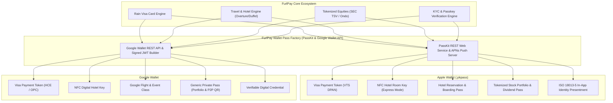
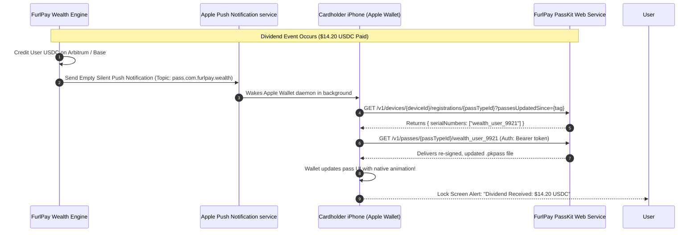
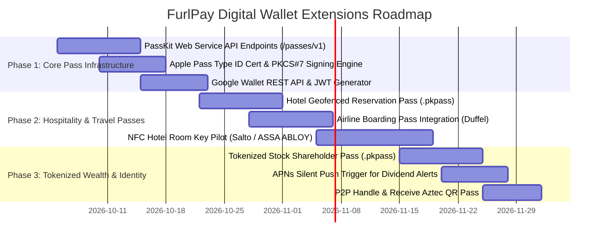

# FurlPay: Digital Wallet Passes, Credential Extensions & Ecosystem Architecture
## Expanding Apple Wallet & Google Wallet Beyond Payment Cards: Hotel Keys, Tokenized Equities, Digital Identity & Dynamic Passes
**Date:** September 2026 | **Author:** FurlPay Core Platform, Systems Architecture & Mobile Engineering  
**Scope:** Apple Wallet (`PassKit`, `.pkpass`, Web Service API, APNs) & Google Wallet (`Google Wallet API`, `Generic Pass`, `Hotel Keys`, `JWT`)

---

## Executive Summary

While payment card push-provisioning (Visa via Rain) represents the transactional foundation of FurlPay, **Apple Wallet** and **Google Wallet** have evolved into comprehensive operating system-level credential layers. In 2026, mobile wallets are no longer just repositories for debit cards—they serve as the primary user touchpoint for **NFC physical access, dynamic financial asset tracking, airline boarding passes, and sovereign identity credentials**.

By restricting wallet integration to payment cards, FurlPay underutilizes its core product ecosystem:
1. **Travel & Hospitality Engine** (`/travel`, `/hotels/map`): Can issue **NFC Digital Hotel Room Keys** and **Geofenced Reservation Passes**.
2. **Tokenized Equities & Wealth Platform** (`/products/investing`, SEC TSV Exemption): Can issue **Dynamic Shareholder Passes** with live portfolio valuation and automated dividend push alerts.
3. **Sovereign Multi-Currency & P2P Rails**: Can issue **FurlPay Handle & Receive Passes** with lock-screen accessible deposit QR codes.
4. **Compliance & Verification Rails** (`/verify-identity`): Can issue **Verifiable KYC & mDL Digital Identity Credentials**.

This report specifies the architecture, data schemas, cryptographic requirements, and server implementation needed to deploy these passes at scale.



---

## 1. Complete Taxonomy: What Should Be Added to Mobile Wallets

| Wallet Asset Category | Wallet Type | User Value & Functionality | Underlying FurlPay Rail |
| :--- | :--- | :--- | :--- |
| **1. Visa Payment Card** | Payment Pass (EMV/DPAN) | In-store POS tap-to-pay via NFC with JIT USDC settlement | Rain Issuing API + Visa Token Service |
| **2. Hotel Room Keys** | NFC Key Pass | Tap iPhone/Apple Watch to unlock hotel room doors without app | Travel engine (`/hotels/map`, Salto/ASSA ABLOY) |
| **3. Hotel & Flight Passes** | Event / Boarding Pass | Live flight status, boarding group, hotel check-in QR & geofencing | Travel engine (`/travel`, Duffel, Travala) |
| **4. Tokenized Equity Pass** | Generic StoreCard / Private Pass | Live on-chain portfolio valuation, shares held, dividend stream | Investing engine (`/investing`, Ondo, SEC TSV) |
| **5. FurlPay Handle & QR Pass** | Generic Pass | Lock-screen accessible QR code to receive USDC on Base/Arbitrum | P2P Handle & EIP-3009 Receive engine |
| **6. Verifiable KYC Credential** | Digital Identity (mDL / VC) | Cryptographic proof of identity for instant hotel/venue check-in | Compliance engine (`/verify-identity`, Persona) |
| **7. Corporate Expense Pass** | Generic Pass | Real-time remaining daily budget and active expense policy | FurlPay Business & B2B Partner rails |

---

## 2. Deep Dive: Travel & Hotel Passes (FurlPay Hospitality Engine)

FurlPay already maintains a production travel and accommodation infrastructure (`apps/web/src/app/hotels/map`, `apps/web/src/app/api/travel/settle`). By extending this engine into mobile wallets, FurlPay creates an unassailable advantage over traditional OTAs (Booking.com, Expedia).

```
┌─────────────────────────────────────────────────────────────────────────────┐
│                 APPLE WALLET HOTEL RESERVATION & NFC ROOM KEY               │
│                                                                             │
│   ┌─────────────────────────────────────────────────────────────────────┐   │
│   │  MARINA BAY SANDS SINGAPORE                 [ FurlPay Travel ]      │   │
│   │  Deluxe King Harbor View                    Room: 4218              │   │
│   │                                                                     │   │
│   │  CHECK-IN                  CHECK-OUT        GUESTS                  │   │
│   │  28 SEP 2026, 15:00        02 OCT 2026      2 Adults                │   │
│   │                                                                     │   │
│   │  STATUS: Confirmed (Paid via USDC)          SETTLEMENT: 1,840 XSGD  │   │
│   │  NFC ROOM KEY: Active                       EXPRESS MODE: ON        │   │
│   │                                                                     │   │
│   │  |||||||||||||||||||||||||||||||||||||||||||||||||||||||||||||||||  │   │
│   │  *FPSG-MBS-9984102*                                                 │   │
│   └─────────────────────────────────────────────────────────────────────┘   │
│                                                                             │
│   LOCK SCREEN BEHAVIOR (GEOFENCED):                                         │
│   • Triggered automatically when device enters within 200m of hotel GPS     │
│   • Express Mode unlocks room door on tap without unlocking iPhone          │
│   • Works on Power Reserve for up to 5 hours after phone battery is empty   │
└─────────────────────────────────────────────────────────────────────────────┘
```

### A. Hotel Room Keys (NFC Digital Keys)
1. **Apple Wallet Hotel Key Specification**:
   - Built on top of the **Aliro / Car Connectivity Consortium** standard and NXP/STMicroelectronics secure NFC chips.
   - **Express Mode**: Guests unlock their room by holding the top of their iPhone or Apple Watch near the door lock—**no Face ID, Touch ID, or passcode required**.
   - **Power Reserve**: Operates for up to 5 hours after the iPhone battery dies.
   - **Integration Gateway**: Connected through certified lock provider APIs (Salto Space Hospitality, ASSA ABLOY VingCard, or Dormakaba).
2. **Google Wallet Hotel Keys**:
   - Implemented via Google Wallet's dedicated **Hotel Key API** (distinct from Generic Passes).
   - Requires provisioning through an authorized hospitality service provider, binding the digital key directly to the guest’s Google Account.

### B. Geofenced Reservation Passes (`.pkpass`)
* **Geofencing (`locations` array)**:
  Apple Wallet automatically surfaces the reservation pass on the user's lock screen when they arrive at the hotel coordinates:
  ```json
  "locations": [
    {
      "latitude": 1.2838,
      "longitude": 103.8591,
      "relevantText": "Welcome to Marina Bay Sands! Tap to view check-in barcode."
    }
  ]
  ```
* **Dynamic Date Scheduling (`relevantDate`)**:
  Surfaces a notification 2 hours prior to scheduled check-in time (`2026-09-28T13:00:00+08:00`).

---

## 3. Deep Dive: Tokenized Equities & Shareholder Passes (SEC Innovation Exemption)

Under the SEC’s September 17, 2026 Innovation Exemption for Tokenized Securities Venues (TSVs), FurlPay users hold genuine direct ownership of tokenized U.S. equities (AAPL, NVDA, TSLA) on-chain. FurlPay can represent these investments as **Dynamic Portfolio Passes** inside Apple Wallet and Google Wallet.

```
┌─────────────────────────────────────────────────────────────────────────────┐
│                 TOKENIZED EQUITIES DYNAMIC SHAREHOLDER PASS                 │
│                                                                             │
│   ┌─────────────────────────────────────────────────────────────────────┐   │
│   │  FURLPAY WEALTH • SEC TSV QUALIFIED         [ Verified Shareholder ]│   │
│   │  PORTFOLIO VALUE: $ 48,250.80 USDC          ▲ +$1,240.20 (+2.64%)   │   │
│   │                                                                     │   │
│   │  TOP HOLDINGS:                                                      │   │
│   │  • AAPL: 45.20 Shares ($10,325.94)                                  │   │
│   │  • NVDA: 120.00 Shares ($14,880.00)                                 │   │
│   │  • VOO:  50.00 Shares ($23,044.86)                                  │   │
│   │                                                                     │   │
│   │  DIVIDEND REVENUE (YTD): $ 642.50 USDC (Auto-Streamed to Wallet)    │   │
│   │  PROXY VOTING STATUS: 2 Active Votes Pending                        │   │
│   │                                                                     │   │
│   │  [ TAP TO CAST PROXY VOTES VIA FURLPAY AGENT ]                      │   │
│   └─────────────────────────────────────────────────────────────────────┘   │
│                                                                             │
│   LOCK SCREEN NOTIFICATION TRIGGER (VIA SILENT APNS PUSH):                  │
│   "Apple Inc. paid $14.20 dividend. Automatically credited to your USDC."   │
└─────────────────────────────────────────────────────────────────────────────┘
```

### A. Dynamic Balance Updates via Apple PassKit Web Service
Apple Wallet passes do not poll servers; they update via a **silent push notification sequence**:



### B. Fields and Change Messages
In `pass.json`, assigning a `changeMessage` to primary fields ensures that whenever the server delivers an updated `.pkpass`, Apple Wallet surfaces an explicit lock-screen banner:
```json
{
  "primaryFields": [
    {
      "key": "portfolioValue",
      "label": "TOTAL PORTFOLIO",
      "value": 48250.80,
      "currencyCode": "USD",
      "changeMessage": "Portfolio value updated to %@."
    }
  ],
  "secondaryFields": [
    {
      "key": "lastDividend",
      "label": "RECENT DIVIDEND",
      "value": "AAPL • $14.20 USDC",
      "changeMessage": "New dividend credited: %@."
    }
  ]
}
```

---

## 4. Deep Dive: FurlPay Handle & Crypto P2P Receive Pass

To simplify crypto remittances, FurlPay can issue a **Public Receive Pass**:
* **Front Face**: Displays the user’s avatar, verified handle (`@alex.furlpay`), and a high-contrast Aztec / QR barcode encoding their universal payment deep-link (`https://furlpay.com/pay/@alex`).
* **Multi-Chain Address Book**: The back of the pass lists their verified public deposit addresses:
  - Arbitrum / Base USDC: `0x71C...49A`
  - Solana USDC: `EPjF...v1v`
  - Singapore PayNow Proxy: `+65 9123 4567`
* **Utility**: The user can double-click the side button of their iPhone or Apple Watch anywhere in the world to immediately present their deposit QR code without needing cellular data or unlocking their banking app.

---

## 5. Server Architecture: Implementing the PassKit Web Service

To support dynamic Apple Wallet passes, FurlPay’s web API (`apps/web`) must implement the standard **Apple PassKit REST Web Service Specification**.

```
┌─────────────────────────────────────────────────────────────────────────────┐
│                    FURLPAY PASSKIT REST WEB SERVICE ROUTES                  │
│                                                                             │
│   POST   /api/passes/v1/devices/{deviceId}/registrations/{passType}/{serial}│
│          • Registers a device to receive push updates for a pass            │
│          • Stores pushToken in Supabase / KV                                │
│                                                                             │
│   GET    /api/passes/v1/devices/{deviceId}/registrations/{passType}         │
│          • Queries passes updated since a given timestamp                   │
│                                                                             │
│   GET    /api/passes/v1/passes/{passType}/{serial}                          │
│          • Generates, cryptographically signs, and streams the .pkpass file │
│                                                                             │
│   DELETE /api/passes/v1/devices/{deviceId}/registrations/{passType}/{serial}│
│          • Unregisters device when a pass is deleted from Apple Wallet      │
│                                                                             │
│   POST   /api/passes/v1/log                                                 │
│          • Ingests error logs transmitted by Apple Wallet clients           │
└─────────────────────────────────────────────────────────────────────────────┘
```

### A. The PassKit Endpoint Implementation (`apps/web`)
```typescript
import { NextRequest, NextResponse } from "next/server";
import { kvSet, kvGet, kvDel } from "@/lib/kv";
import { rateLimitOr429 } from "@/lib/rateLimit";

// POST /api/passes/v1/devices/:deviceId/registrations/:passType/:serial
export async function POST(
  req: NextRequest,
  props: { params: Promise<{ deviceId: string; passType: string; serial: string }> }
) {
  const { deviceId, passType, serial } = await props.params;

  // 1. Verify Authorization Header: ApplePass <authenticationToken>
  const authHeader = req.headers.get("authorization");
  if (!authHeader?.startsWith("ApplePass ")) {
    return new NextResponse(null, { status: 401 });
  }
  const token = authHeader.replace("ApplePass ", "").trim();

  // 2. Validate token against stored pass secret in database
  const expectedToken = await kvGet(`pass:token:${passType}:${serial}`);
  if (token !== expectedToken) {
    return new NextResponse(null, { status: 401 });
  }

  // 3. Extract pushToken from body
  const body = await req.json();
  const pushToken = body.pushToken;

  // 4. Register device in storage
  await kvSet(`pass:reg:${passType}:${serial}:${deviceId}`, { pushToken, updatedAt: Date.now() });

  return new NextResponse(null, { status: 201 });
}
```

### B. Cryptographic `.pkpass` Assembly and Signing
A `.pkpass` file is a ZIP archive containing:
1. `pass.json`: The layout, colors, fields, and barcodes.
2. Icon & Image Assets: `icon.png`, `icon@2x.png`, `logo.png`, `strip.png`.
3. `manifest.json`: A JSON dictionary mapping every filename to its SHA-1 checksum.
4. `signature`: A PKCS #7 detached signature generated using FurlPay’s **Apple Pass Type ID Certificate** and Apple’s WWDR (Worldwide Developer Relations) G4 intermediate certificate.

---

## 6. Google Wallet Implementation: Generic Passes & JWT Claims

Google Wallet uses a server-to-server REST API and signed JSON Web Tokens (JWT) rather than signed ZIP packages.

### A. Google Wallet Generic Object Architecture
1. **Define a Generic Class** (Once per tenant):
   Defines the template, branding, and color scheme (`furlpay_wealth_class_v1`).
2. **Define a Generic Object** (Per user):
   Defines the individual pass data, user handle, and balance.

```typescript
import { GoogleAuth } from "google-auth-library";
import jwt from "jsonwebtoken";

export function createGoogleWalletJwt(user: { id: string; name: string; portfolioUsd: number }) {
  const genericObject = {
    id: `3388000000022119988.${user.id}_wealth`,
    classId: "3388000000022119988.furlpay_wealth_class_v1",
    logo: {
      sourceUri: { uri: "https://furlpay.com/assets/furlpay-logo-neon.png" },
      contentDescription: { defaultValue: { language: "en-US", value: "FurlPay Logo" } }
    },
    cardTitle: {
      defaultValue: { language: "en-US", value: "FurlPay Tokenized Wealth" }
    },
    header: {
      defaultValue: { language: "en-US", value: `$${user.portfolioUsd.toFixed(2)} USDC` }
    },
    subheader: {
      defaultValue: { language: "en-US", value: "Total Portfolio (SEC TSV Qualified)" }
    },
    barcode: {
      type: "QR_CODE",
      value: `https://furlpay.com/pay/@${user.name}`,
      alternateText: `@${user.name}`
    },
    hexBackgroundColor: "#000000"
  };

  // Sign with Google Service Account private key
  const claims = {
    iss: process.env.GOOGLE_WALLET_ISSUER_EMAIL,
    aud: "google",
    origins: ["https://furlpay.com"],
    typ: "savetowallet",
    payload: { genericObjects: [genericObject] }
  };

  const token = jwt.sign(claims, process.env.GOOGLE_WALLET_PRIVATE_KEY!, { algorithm: "RS256" });
  return `https://pay.google.com/gp/v/save/${token}`;
}
```

---

## 7. Master Implementation Roadmap for Wallet Extensions



### Action Items & Verification Milestones
1. **PassKit Web Service Deployment**: Implement `/api/passes/v1/` routes in `apps/web` with rate-limiting and token verification.
2. **Dynamic Dividend Alerts**: Hook the dividend settlement engine (`/api/dividends/settle`) directly to the APNs push dispatcher to notify users in real-time when on-chain stock yields settle.
3. **Hotel Booking "Add to Wallet" Button**: Add the official Apple Wallet (`Add_to_Apple_Wallet_Badge.svg`) and Google Wallet buttons to the hotel confirmation screen (`apps/web/src/app/travel/booking/confirmation`).

---
*Report compiled autonomously via Antigravity Agentic Intelligence. Grounded in Apple PassKit Web Service Specifications, Apple Wallet Hotel Key Program Guides, Google Wallet API v1 Reference, and ISO/IEC 18013-5 Standards as of September 25, 2026.*
