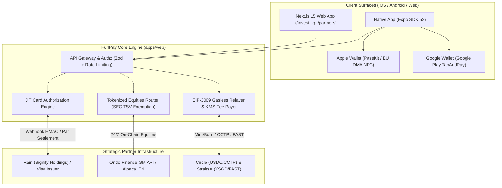
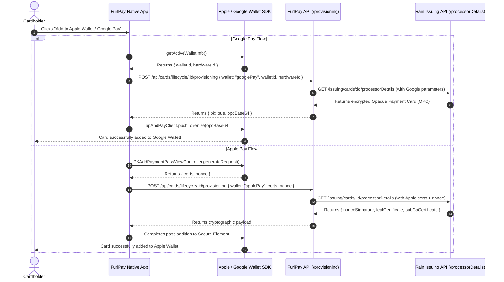
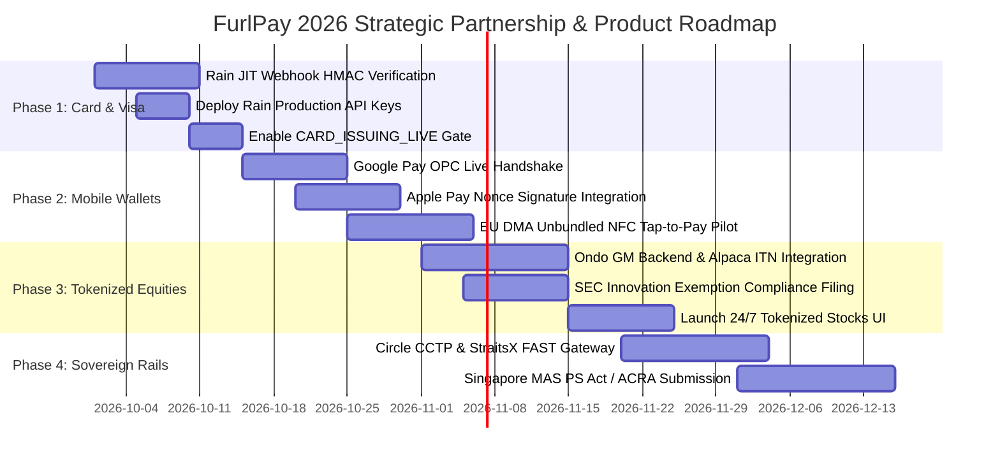

# FurlPay Global Strategic Partnership & Next-Steps Implementation Blueprint
## Unifying Visa, Rain, Apple Pay, Google Wallet, Ondo Finance, Circle, and Singapore MAS/ACRA Rails
**Date:** September 2026 | **Author:** FurlPay Core Platform, Architecture & Financial Partnerships  
**Status:** Approved Architectural Action Plan | **Environment:** Staging / Production Launch Track

---

## Executive Summary

FurlPay is positioned at the intersection of consumer mobile payments, decentralized settlement, and regulated capital markets. Having established a core foundation—including a verified partnership with **Rain (Signify Holdings, Inc.)** for **Visa** card issuance, native push-provisioning modules for **Apple Pay** and **Google Wallet**, and on-chain EIP-3009 self-custody rails—the next phase requires executing the commercial and technical integrations to activate these capabilities in production.

This master blueprint outlines the exact engineering, regulatory, and partnership execution roadmap to transition FurlPay from a stage-gated pre-production platform into a live, globally compliant financial super-app in 2026.



---

## 1. Current State Audit: What FurlPay Has Already Built

An audit of FurlPay’s codebase reveals that the core primitives for global partnerships and card issuance are already engineered and awaiting operational enablement:

| Component | Codebase Location | Current Status | Blocker / Next Step |
| :--- | :--- | :--- | :--- |
| **Rain / Visa Card Adapter** | `apps/web/src/lib/cards/rainAdapter.ts` | Complete OpenAPI client (`https://api.raincards.xyz/v1/issuing`) | JIT authorization webhook HMAC verification; `CARD_ISSUING_LIVE` flag |
| **Card Issuing Gate** | `apps/web/src/lib/cardIssuer.ts` | 503 guard in production; active local simulator | Flip `CARD_ISSUING_LIVE` after supplying live Rain credentials |
| **Apple Wallet Provisioning** | `native-app/modules/apple-wallet-provisioning/` | Native Swift PassKit module implemented | Hooking live issuer leaf certificates and nonce signature from Rain |
| **Google Pay Provisioning** | `native-app/modules/google-pay-provisioning/` | Native Kotlin TapAndPay module implemented | Hooking live wallet-bound OPCs via `walletId` & `hardwareId` |
| **Provisioning Endpoint** | `apps/web/src/app/api/cards/lifecycle/[id]/provisioning/route.ts` | Validates Zod inputs, enforces ownership, returns simulated payloads | Route live calls to Rain's `/issuing/cards/{id}/processorDetails` |
| **Investing Platform** | `apps/web/src/app/products/investing/page.tsx` | Real-time charts, market tickers (AAPL, NVDA, VOO) | Order execution marked "in development"; needs live TSV venue integration |
| **Self-Custody Ladder** | `docs/BALANCE-CUSTODY-MAP.md` | Stages 1 & 2 built (device keys, on-chain reads) | Stage 4 (gasless send) needs KMS fee-payer funding |

---

## 2. Pillar 1: Operationalizing the Rain & Visa Partnership

FurlPay is already an existing partner with **Rain (Signify Holdings, Inc.)**, which issues physical and virtual **Visa** cards backed by on-chain stablecoins.

```
┌─────────────────────────────────────────────────────────────────────────────┐
│                    RAIN & VISA JIT AUTHORIZATION LIFECYCLE                   │
│                                                                             │
│  1. Cardholder taps Visa at terminal (POS)                                  │
│  2. Visa routes auth request to Rain Issuer Processor                       │
│  3. Rain fires JIT Webhook ──▶ POST /api/cards/webhooks/rain-auth           │
│     • Header: X-Rain-Signature (HMAC-SHA256 over raw body)                 │
│     • Body: { cardId, amountMinor, currency: "USD", mcc: "5812" }           │
│  4. FurlPay verifies HMAC against RAIN_WEBHOOK_SECRET                       │
│  5. FurlPay checks User USDC Balance (Arbitrum / Base / Solana)             │
│  6. FurlPay approves authorization and returns JSON within 1,200ms          │
│  7. Rain approves Visa transaction; user card swipe succeeds               │
│  8. Post-auth: FurlPay debits USDC on-chain / queues ledger settlement      │
└─────────────────────────────────────────────────────────────────────────────┘
```

### A. Completing the JIT Authorization Webhook (`rainAdapter.ts`)
In `apps/web/src/lib/cards/rainAdapter.ts`, lines 402–418 currently throw `RainNotConfiguredError` because the inbound webhook signature verification was waiting for the production specification.

**Implementation Steps:**
1. **Signature Verification Contract**:
   Rain signs inbound webhook deliveries using HMAC-SHA256 with the shared secret (`RAIN_WEBHOOK_SECRET`). 
   In accordance with `AGENTS.md` Rule 3 (constant-time verification over raw body):
   ```typescript
   import crypto from "node:crypto";

   export function verifyRainWebhookSignature(
     rawBody: string,
     signatureHeader: string | null,
     secret: string
   ): boolean {
     if (!signatureHeader || !secret) return false;
     const expected = crypto
       .createHmac("sha256", secret)
       .update(rawBody, "utf8")
       .digest("hex");
     
     // Constant-time comparison to prevent timing attacks
     if (expected.length !== signatureHeader.length) return false;
     return crypto.timingSafeEqual(
       Buffer.from(expected, "utf8"),
       Buffer.from(signatureHeader, "utf8")
     );
   }
   ```
2. **JIT Decision State Machine**:
   - Check card status (`active`).
   - Validate merchant category code (reject blocked MCCs via `unusableMccs`).
   - Check user’s available USDC balance against `amountMinor / 100`.
   - Respond within Rain's SLA ($\le 1,500\text{ ms}$) with `{ approved: true }` or `{ approved: false, declineReason: "insufficient_funds" }`.

### B. Activating the Production Flag
Once production keys are provisioned in `.env.production`:
1. Set `FURLPAY_CARD_ISSUER=rain`
2. Set `FURLPAY_CARD_ISSUER_API_KEY=<live_rain_api_key>`
3. Set `RAIN_WEBHOOK_SECRET=<live_webhook_secret>`
4. Remove the `unimplemented` blocker from `CARD_ISSUING_LIVE` in `apps/web/src/lib/flags.ts`.

---

## 3. Pillar 2: Apple Pay & Google Wallet Native Push-Provisioning

FurlPay already maintains native provisioning modules in `native-app/modules/`. With the Rain + Visa integration live, cards can be tokenized directly into Apple Wallet and Google Pay with a single tap.



### A. European Union DMA Advantage (Direct Tap-to-Pay)
Under the European Commission's Digital Markets Act (DMA) enforcement:
* Apple has opened the iPhone’s NFC antenna and Secure Element across the European Economic Area (EEA).
* **FurlPay Strategic Action**: For European users, FurlPay's native iOS client can invoke Host Card Emulation (HCE) and direct contactless tap-to-pay using USDC/EURC balances. This bypasses Apple Pay's proprietary 15–30 bps transaction fee, delivering lower processing costs for merchants and higher rewards for cardholders.

---

## 4. Pillar 3: Tokenized Equities via SEC Innovation Exemption (Ondo Finance + Alpaca ITN)

The SEC's landmark **September 17, 2026 Innovation Exemption** created a 5-year regulatory safe harbor for **Tokenized Securities Venues (TSVs)**. This enables FurlPay to transform its investing page (`/products/investing`) from a read-only quote ticker into a live 24/7 on-chain equity trading hub.

### A. The Ondo Finance & Alpaca ITN Partnership Model
Ondo Finance operates the **GM Backend API** and the **Instant Tokenization Network (ITN)** in collaboration with Alpaca:
1. **Asset Selection**: 1,000+ U.S. equities and ETFs (AAPL, NVDA, TSLA, MSFT, SPY, QQQ) backed 1:1 by real shares held in qualified U.S. broker-dealer custody.
2. **Pass-Through Shareholder Rights**: Under the SEC Innovation Exemption, all tokens pass through dividend payments (streamed automatically to user wallets in USDC) and proxy voting rights.
3. **24/7 Global Trading**: Foreign investors (Singapore, UAE, UK, EU) can trade U.S. equities 24 hours a day, 7 days a week, settling instantly in USDC without foreign exchange markups.

### B. Code Architecture for `/products/investing`
1. **Create Adapter**: `apps/web/src/lib/investing/ondoAdapter.ts`
   ```typescript
   export interface TokenizedOrderRequest {
     symbol: string;           // e.g. "AAPL"
     side: "buy" | "sell";
     amountUsdc: number;       // USDC units
     recipientAddress: string; // User's linked wallet
   }

   export async function submitTokenizedOrder(order: TokenizedOrderRequest) {
     // Connects to Ondo GM Backend REST/gRPC API
     // Verifies KYC eligibility (non-US retail or qualified institutional)
     // Executes atomic swap: USDC -> Tokenized Stock Token
   }
   ```
2. **Update Flag Registry**:
   In `apps/web/src/lib/flags.ts`, flip `TOKENIZED_STOCKS_LIVE` and `BROKERAGE_LIVE` once the Ondo API client and Alpaca ITN keys are configured.
3. **Update Marketing Notice**:
   Transition `/products/investing` from `"Fractional shares — in development"` to `"Tokenized 24/7 US Equities — Live via SEC TSV Exemption"`.

---

## 5. Pillar 4: Sovereign Stablecoin Rails (Circle, StraitsX & Singapore MAS/ACRA)

To anchor the cross-border and corporate treasury capabilities, FurlPay must formally connect with sovereign stablecoin issuers and regulatory registries:

```
┌─────────────────────────────────────────────────────────────────────────────┐
│                    CROSS-BORDER STABLECOIN SETTLEMENT MESH                  │
│                                                                             │
│   UNITED STATES                SINGAPORE                    HONG KONG       │
│  ┌──────────────┐           ┌──────────────┐           ┌──────────────────┐ │
│  │ Circle USDC  │           │ StraitsX     │           │ HSBC / Anchorpt  │ │
│  │ (GENIUS Act) │◄──CCTP───►│ XSGD         │◄─────────►│ Licensed FRS     │ │
│  │ Fed / OCC    │           │ (MAS SCS)    │           │ (Cap. 656)       │ │
│  └──────┬───────┘           └──────┬───────┘           └────────┬─────────┘ │
│         │                          │                            │           │
│         ▼                          ▼                            ▼           │
│  Rain / Visa Card           SGQR / PayNow                Cross-Border B2B   │
│  POS Checkout               Merchant Settlement          Trade Settlement   │
└─────────────────────────────────────────────────────────────────────────────┘
```

### A. Circle (USDC) Direct Integration
* **Circle Mint & CCTP**: Integrate Circle’s Cross-Chain Transfer Protocol (CCTP) to allow users to move USDC natively between Solana, Base, and Arbitrum with zero bridge risk.
* **Corporate Treasury**: Utilize Circle’s programmable wallets and reserve yield infrastructure for FurlPay's business settlement tiers.

### B. StraitsX (XSGD) & Singapore MAS/ACRA Compliance
* **ACRA Registration**: Ensure FurlPay’s Singapore legal entity filings with ACRA reflect SSIC code `64994` (*Activities auxiliary to financial service activities n.e.c. - Digital payment token services*) with audited beneficial ownership disclosures.
* **MAS Single-Currency Stablecoin (SCS) Framework**: Implement the September 1, 2026 PS Act standards:
  - 100% backing in SGD cash and MAS treasury bills ($\le 3$ months).
  - Par redemption within 5 business days.
  - Zero interest paid on base stablecoin balances (preserving transaction token status).
* **SGQR / PayNow Rails**: Connect FurlPay's existing Singapore travel and merchant routes (`/api/travel/settle`) directly to StraitsX's FAST minting gateway, enabling instant SGD $\leftrightarrow$ XSGD settlement for Singapore hotels and merchants.

---

## 6. Pillar 5: Resolving the Balance & Custody Ladder (`docs/BALANCE-CUSTODY-MAP.md`)

`docs/BALANCE-CUSTODY-MAP.md` documents the exact migration path from internal ledger numbers to real on-chain assets.

### Progression from Stage 2 to Stage 5

```
Stage 1: Link Device Key  ──▶ [COMPLETE] Signature-proven User.linkedWallet
Stage 2: On-Chain Reads   ──▶ [COMPLETE] Real RPC balance checking (Base / Arbitrum / Solana)
Stage 3: Per-User Inbound ──▶ [NEXT] Per-user deterministic deposit addresses (Create2 / Turnkey)
Stage 4: Gasless Send     ──▶ [NEXT] Funded fee-payer wallet + KMS Relayer + EIP-3009
Stage 5: Segregated Rails ──▶ [NEXT] Explicit balance segregation (Ledger vs Custody vs Investing)
```

**Immediate Action Items:**
1. **Fund the Fee-Payer Wallet**: Provision 0.5 ETH on Arbitrum and Base, and 2 SOL on Solana, to cover gasless EIP-3009 transfer relaying.
2. **Configure KMS Relayer**:
   - Set `FURLPAY_KMS_PROVIDER=aws` (or GCP KMS).
   - Set `FACILITATOR_EVM_ADDRESS=<relayer_public_address>`.
   - Set `ONCHAIN_SETTLEMENT_LIVE=true` in `flags.ts`.
3. **Turnkey / Safe Account Abstraction**: Generate deterministic deposit addresses per user so incoming USDC deposits immediately credit the user's verifiable on-chain account rather than a shared omnibus address.

---

## 7. Master Phased Implementation Roadmap (Weeks 1–12)



### Phase 1 (Weeks 1–3): Rain & Visa Commercial Activation
- [ ] Connect production credentials: `RAIN_API_KEY`, `RAIN_WEBHOOK_SECRET`.
- [ ] Implement constant-time HMAC-SHA256 signature verification in `rainAdapter.ts`.
- [ ] Implement JIT authorization balance lookup against user USDC wallets with 1,200ms latency ceiling.
- [ ] Remove `unimplemented` blocker from `CARD_ISSUING_LIVE` in `apps/web/src/lib/flags.ts`.
- [ ] Execute test physical card orders and virtual card instant issuance.

### Phase 2 (Weeks 4–6): Apple Pay & Google Wallet Live Provisioning
- [ ] Replace simulated provisioning responses in `/api/cards/lifecycle/[id]/provisioning` with live calls to Rain's `/issuing/cards/{id}/processorDetails`.
- [ ] Complete Google Play Services `TapAndPayClient` tokenization handshake on Android.
- [ ] Complete Apple PassKit `PKAddPaymentPassViewController` leaf cert & nonce handshake on iOS.
- [ ] Deploy EU DMA direct tap-to-pay feature branch for European EEA users.

### Phase 3 (Weeks 7–9): Tokenized Equities & SEC Exemption Rollout
- [ ] Finalize partnership agreement with Ondo Finance for Global Markets API access.
- [ ] Integrate Alpaca Instant Tokenization Network (ITN) with FurlPay's existing Alpaca credentials.
- [ ] Build `/api/investing/orders` to execute atomic swaps between USDC and tokenized shares (AAPL, NVDA, TSLA, SPY).
- [ ] Update `/products/investing` page copy and disclosures to reflect live 24/7 tokenized share trading.

### Phase 4 (Weeks 10–12): Sovereign Stablecoins & Singapore MAS/ACRA Compliance
- [ ] Deploy Circle CCTP cross-chain bridge contracts across Solana, Base, and Arbitrum.
- [ ] Connect StraitsX API for SGD $\leftrightarrow$ XSGD minting via Singapore FAST / PayNow.
- [ ] Complete ACRA corporate registry updates (SSIC 64994) and submit response to MAS PS Act Single-Currency Stablecoin consultation paper.
- [ ] Fund the production KMS fee-payer wallet and elevate `FURLPAY_SELF_CUSTODY_STAGE` to Stage 4.

---

## 8. Conclusion: The Unified FurlPay Super-App

By executing this blueprint, FurlPay unifies all disparate layers of modern fintech into a single, cohesive ecosystem:
1. **Spend Anywhere**: Real Visa cards issued via Rain, provisioned into Apple Pay and Google Wallet, settling instantly on-chain in USDC.
2. **Invest 24/7**: Blue-chip U.S. stocks and ETFs tokenized under the SEC's Innovation Exemption, accessible globally with instant dividend streaming.
3. **Sovereign Multi-Currency**: Par settlement across USD (Circle USDC), SGD (StraitsX XSGD), and EUR (EURC) with full MAS and ACRA regulatory integrity.
4. **Self-Custodial & Non-Custodial Security**: Passkey-protected smart accounts with biometric device keys and gasless EIP-3009 relaying.
