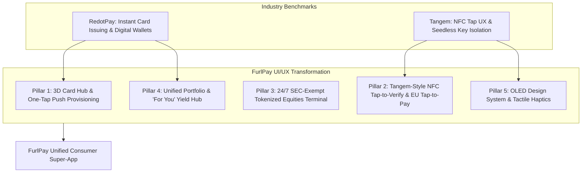

# FurlPay UI/UX Architecture & Feature Enhancement Master Report
## Deep Codebase Analysis, RedotPay & Tangem Benchmarking, and Next-Gen Product Design
**Date:** September 2026 | **Author:** FurlPay Core Product Design & Mobile Engineering  
**Scope:** `native-app/` (Expo SDK 52 iOS/Android) & `apps/web/` (Next.js 15 App Router)

---

## Executive Summary

To establish FurlPay as the definitive global financial super-app, the user experience must match and exceed the world's most successful crypto-fintech and hardware-security platforms:
1. **RedotPay**: The benchmark for high-velocity stablecoin card issuing, instantaneous Apple Pay/Google Pay push-provisioning, multi-currency auto-deduction, and tiered cashback rewards.
2. **Tangem**: The benchmark for seedless security, tactile NFC tap-to-sign interactions, clean OLED dark aesthetics, multi-chain portfolio transparency, and cold-to-card liquidity control (Tangem Pay).

This report presents an exhaustive audit of FurlPay’s current client codebase, identifies structural friction points and unfinished UX seams, and delivers a concrete, production-ready blueprint for UI/UX enhancements and feature upgrades.



---

## 1. Codebase Audit: Current State of FurlPay UI/UX

An inspection of `native-app/app/` and `apps/web/` highlights strong architectural foundations paired with critical user-facing gaps:

### A. The Cards Tab (`native-app/app/(tabs)/cards.tsx`)
* **Current UI**: Renders a 2D linear gradient `CardVisual` inside a FlatList carousel, followed by a status chip and toggles for Freeze, Limits, and Channels.
* **The Gap**:
  1. **Missing Wallet Button**: There is **no "Add to Apple Wallet" or "Add to Google Pay" button** on the main cards tab. Users must drill down into `cards/[id].tsx` to even discover that digital wallets exist.
  2. **Flat Aesthetic**: Unlike RedotPay's glossy, tactile debit cards with metallic finishes and chip specular highlights, FurlPay's card visuals appear flat and static.
  3. **No Top-Up Shortcut**: To fund a card, the user has to switch tabs to Home or Send/Receive. There is no direct "Top Up with USDC" quick-action on the card itself.

### B. Single Card Lifecycle Screen (`native-app/app/cards/[id].tsx`)
* **Current UI**: Manages PIN, activation code, card replacement, and device wallet toggles.
* **The Critical UX Blocker**:
  - In lines 256–284, Google Pay and Apple Pay are rendered as simple **Switch toggles** (`<ToggleRow>`) that update an internal preference record (`m.setProvisioning.mutateAsync`).
  - Below them, an apologetic note reads: *"Completing the hand-off to Google Pay or Apple Pay isn't available yet."*
  - **The Disconnect**: The actual native provisioning modules **already exist in the codebase** (`native-app/modules/apple-wallet-provisioning/` and `native-app/modules/google-pay-provisioning/`), as does the client helper in `native-app/lib/cards/provisioning.ts`. The UI simply failed to wire the real push button to `startApplePayProvisioning()` and `startGooglePayProvisioning()`.

### C. Home Dashboard (`native-app/app/(tabs)/index.tsx`)
* **Current UI**: Renders an avatar greeting, unread bell, `BalanceHero`, 8 quick actions in a 2x4 grid, a horizontal scrollview of balances, and recent transactions.
* **The Gap**:
  1. **No Privacy Mode**: High-net-worth users cannot mask their total balance in public spaces (e.g. holding the phone on a subway).
  2. **Fragmented Balances**: Token balances (USDC on Base, Arbitrum, Solana) and fiat balances are shown as plain text boxes without percentage allocations or asset distribution charts.
  3. **Lack of Dynamic Context**: No personalized financial insights, cashback progress, or high-yield staking opportunities (similar to Tangem’s "For You" feed).

### D. Investing Screen (`native-app/app/(tabs)/invest.tsx`)
* **Current UI**: Displays portfolio balance, market movers, trending carousels, and research articles. Dividend settlement (cash vs. DRIP) is cleanly implemented.
* **The Gap**: Order execution is missing. Users can look at charts and read research, but cannot buy or sell tokenized shares. With the SEC’s September 17, 2026 Innovation Exemption now live, this screen must evolve into a live, 24/7 trading interface.

---

## 2. RedotPay Architecture & UX Deconstruction

RedotPay is widely regarded as the gold standard for crypto card UX. Examining their mobile application and API design reveals several core patterns to integrate into FurlPay:

```
┌─────────────────────────────────────────────────────────────────────────────┐
│                       REDOTPAY CARD UX ARCHITECTURE                         │
│                                                                             │
│   ┌─────────────────────────────────────────────────────────────────────┐   │
│   │                      [ VIRTUAL VISA GOLD ]                          │   │
│   │   FurlPay Business                         4111 •••• •••• 8834      │   │
│   │   $ 14,250.80 USDC                         EXP 09/29    CVV •••     │   │
│   │   [● ACTIVE]                               VISA BUSINESS DEBIT      │   │
│   └─────────────────────────────────────────────────────────────────────┘   │
│                                                                             │
│   [ + Add to Apple Wallet ]           [ + Add to Google Pay ]               │
│                                                                             │
│   ┌───────────────┐ ┌───────────────┐ ┌───────────────┐ ┌───────────────┐   │
│   │    Top Up     │ │  Card Details │ │ Freeze / Thaw │ │ Spending Caps │   │
│   │  (Arbitrum)   │ │  (Biometric)  │ │   (Haptic)    │ │   (Sliders)   │   │
│   └───────────────┘ └───────────────┘ └───────────────┘ └───────────────┘   │
│                                                                             │
│   PAYMENT DEDUCTION SEQUENCE (Drag to re-order)                             │
│   1. USDC (Arbitrum / Base) ── Available: $12,400.00                        │
│   2. XSGD (StraitsX FAST)   ── Available: $ 2,450.00                        │
│   3. Ondo USDY (Yield Pool) ── Available: $ 5,000.00 (5.1% APY)            │
└─────────────────────────────────────────────────────────────────────────────┘
```

### Key RedotPay Features for FurlPay:
1. **The Floating Quick-Action Bar**:
   Four key actions live immediately beneath the card preview:
   - **Top Up**: Opens a multi-chain deposit bottom sheet (USDC on Base, Arbitrum, Solana; XSGD on StraitsX).
   - **Card Details**: Authenticates with Face ID / Fingerprint and flips the card or displays an overlaid sheet showing full PAN, CVV, and Expiry with an animated **15-second countdown timer** before auto-masking.
   - **Freeze/Thaw**: A single-tap toggle with immediate tactile haptic feedback and dynamic card recoloring (frosted glass blur when frozen).
   - **Spending Caps**: Interactive stepper meters for daily spend, per-transaction limits, and ATM withdrawals.
2. **Dedicated One-Tap Push Provisioning Button**:
   - For unprovisioned cards, an official Apple Pay (black rounded rectangle with white Apple Pay logo) or Google Pay button is prominently displayed.
   - Once provisioned, it seamlessly morphs into an emerald badge: `✓ Added to Apple Wallet`.
3. **Multi-Asset Deduction Priority List**:
   - Users can drag and reorder their payment priority list. If a card purchase of \$150 is made and the user only has \$100 in USDC, the engine automatically draws the remaining \$50 from the secondary token (e.g. XSGD or Ondo USDY), eliminating point-of-sale card declines.
4. **Tiered VIP Cashback Engine**:
   - A visual progress ring showing monthly spend and cashback percentage (e.g., *VIP 1: 1.0%*, *VIP 2: 1.5%*, *VIP 3: 2.5%*).

---

## 3. Tangem Architecture & UX Deconstruction

Tangem’s open-source architecture (`tangem-app-ios` and `tangem-app-android`) provides the industry benchmark for hardware-grade security without seed-phrase complexity:

```
┌─────────────────────────────────────────────────────────────────────────────┐
│                         TANGEM NFC TAP UX WORKFLOW                          │
│                                                                             │
│         User initiates sensitive action:                                    │
│         • Transfer $1,000+ USDC                                             │
│         • Reveal Full Card PAN & CVV                                        │
│         • Authorize Tokenized Stock Trade                                   │
│                                                                             │
│                                ┌─────────┐                                  │
│                                │  PHONE  │                                  │
│                                │   NFC   │                                  │
│                                └────┬────┘                                  │
│                                     │                                       │
│                           Tap card to back of device                        │
│                                     ▼                                       │
│                           ┌───────────────────┐                             │
│                           │   PHYSICAL CARD   │                             │
│                           │  (Embedded Chip)  │                             │
│                           └───────────────────┘                             │
│                                                                             │
│         1. Native NFC Reader session activates (APDU handshake)             │
│         2. Circular pulsing radar animation on screen                       │
│         3. Tangem Card Secure Element signs cryptographic payload           │
│         4. Heavy haptic confirmation + chime on completion                  │
└─────────────────────────────────────────────────────────────────────────────┘
```

### Key Tangem Features for FurlPay:
1. **NFC "Tap-to-Sign" for Physical Visa Cards**:
   - FurlPay issues physical Visa cards through Rain. Because these cards possess embedded NFC/EMV secure elements, FurlPay can implement Tangem-style card verification.
   - Tapping the physical card against the user's iPhone or Android device instantly unlocks high-security actions:
     - Biometric backup recovery;
     - Revealing unmasked virtual card secrets;
     - Authorizing large-value payouts (\$5,000+).
2. **Unified Portfolio Transparency ("All-in-One")**:
   - Header with aggregate net worth, 24-hour dollar and percentage change, and **Discreet Mode** (shake device or tap eye icon to obscure balances).
   - Multi-chain token list with real-time SVG sparklines showing 7-day price trajectories.
3. **The "For You" Intelligence Hub**:
   - Curated feed displaying:
     - Market sentiment (Fear & Greed index);
     - Active DeFi staking yield rates (Morpho USDC vaults);
     - Top movers in tokenized U.S. equities.
4. **Tangem Pay Cold-to-Card Allowance**:
   - Tangem Pay’s model lets users set a daily spending budget on their virtual card, ensuring their main cold-storage treasury is never exposed to POS merchant vulnerabilities.

---

## 4. FurlPay Master UI/UX Enhancement Blueprint

### Pillar 1: Re-Engineering the Cards Experience (`native-app/app/(tabs)/cards.tsx`)

#### A. Interactive 3D Holographic Card Component
Replace the static `CardVisual` with an animated, touch-responsive 3D card:
* **Gyroscope / Tilt Physics**: As the user tilts the phone, apply subtle specular highlights and light reflections across the card surface (mirroring FurlPay's web `CardShader.tsx`).
* **Status Overlays**:
  - **Active**: Crisp emerald gradient with glowing micro-chip indicator.
  - **Frozen**: Frosted glass blur (`blurRadius={20}`) with cyan tint and a prominent lock badge.
  - **Unactivated**: Amber warning beacon prompting one-tap carrier code entry.

#### B. The One-Tap Digital Wallet Provisioning Bar
Place the official Apple Pay / Google Pay push button directly below the card visual:

```tsx
import { canAddToApplePay, canAddToGooglePay, startApplePayProvisioning, startGooglePayProvisioning } from "@/lib/cards/provisioning";

export function WalletProvisioningBar({ card, isProvisioned }: { card: PaymentCard; isProvisioned: boolean }) {
  const [busy, setBusy] = useState(false);
  const isIos = Platform.OS === "ios";

  if (isProvisioned) {
    return (
      <View style={styles.provisionedBadge}>
        <Ionicons name="checkmark-circle" size={18} color={colors.neon} />
        <Text style={styles.provisionedText}>
          {isIos ? "Added to Apple Wallet" : "Added to Google Pay"}
        </Text>
      </View>
    );
  }

  const handlePush = async () => {
    setBusy(true);
    try {
      const res = isIos
        ? await startApplePayProvisioning(card.id)
        : await startGooglePayProvisioning(card.id);
      if (res.success) {
        await Haptics.notificationAsync(Haptics.NotificationFeedbackType.Success);
      }
    } finally {
      setBusy(false);
    }
  };

  return (
    <Pressable style={styles.walletButton} onPress={handlePush} disabled={busy}>
      <Ionicons name={isIos ? "logo-apple" : "logo-google"} size={20} color="#FFFFFF" />
      <Text style={styles.walletButtonText}>
        {isIos ? "Add to Apple Wallet" : "Add to Google Pay"}
      </Text>
    </Pressable>
  );
}
```

#### C. Floating Action Bar
Add a 4-button quick-action strip:
1. `[+] Top Up`: Triggers the instant multi-chain USDC/XSGD deposit modal.
2. `[👁] Details`: Face ID prompt $\to$ reveals PAN, CVV, and Expiry with a 15s timer.
3. `[❄] Freeze`: Haptic slider to freeze/unfreeze card via Rain API.
4. `[⚙] Limits`: Slider controls for daily and per-transaction spending velocity.

---

### Pillar 2: Integrating Tangem-Style NFC Tap & EU DMA Contactless

#### A. NFC Card Tap-to-Verify Modal
For physical cardholders, introduce an NFC authorization sheet:
* **Visuals**: A sleek phone illustration with radiating emerald sonar rings.
* **Instruction**: *"Hold your physical FurlPay Visa card against the top back of your device."*
* **Trigger**: Used when confirming high-value sends, resetting the card PIN, or unfreezing an account.

#### B. European Union DMA Tap-to-Pay Mode
In the EEA, where Apple has unbundled the iPhone NFC antenna under the Digital Markets Act:
* Implement an in-app **"Tap to Pay with USDC"** trigger.
* When active, the user can hold their unlocked iPhone near any contactless payment terminal to execute an instant tap payment drawn directly from their self-custodial USDC balance.

---

### Pillar 3: 24/7 SEC-Exempt Tokenized Equities Trading Hub (`invest.tsx`)

Transform `/products/investing` and `native-app/app/(tabs)/invest.tsx` from static market tickers into a 24/7 on-chain trading terminal under the SEC’s September 17, 2026 Innovation Exemption:

```
┌─────────────────────────────────────────────────────────────────────────────┐
│                    24/7 TOKENIZED EQUITIES TRADING TERMINAL                 │
│                                                                             │
│   AAPL • Apple Inc. (Tokenized Common Stock)                                │
│   $ 228.45 USD   ▲ +2.34 (+1.04%) Today   ● Market Open (24/7 TSV)          │
│                                                                             │
│   [ 1D ]  [ 1W ]  [ 1M ]  [ 1Y ]  [ ALL ]          [ Line / Candlestick ]   │
│   ~~~~~~~~~~~~~~~~~~~~~/\/\/\/\~~~~~~~~~~~~~~~~~~~~~~~~~~~~~~~~~~~~~~~~~    │
│                                                                             │
│   SEC INNOVATION EXEMPTION COMPLIANCE BADGE                                 │
│   🛡 1:1 Direct Real Share Backing (DTCC Custodied Broker-Dealer)           │
│   💵 Dividend Stream: Automatically paid in USDC to your linked wallet      │
│   🗳 Corporate Governance: Proxy voting enabled via partner API            │
│                                                                             │
│   ORDER EXECUTION (Settles instantly in USDC via Ondo / Alpaca ITN)         │
│   Amount: [ 250.00 USDC ] ──▶ Approx: 1.0943 AAPL Shares                   │
│   Slippage: [ 0.1% ]  Network Fee: [ $0.00 Gasless ]                        │
│                                                                             │
│   [ SWIPE TO BUY AAPL (24/7 ATOMIC SETTLEMENT) >>> ]                       │
└─────────────────────────────────────────────────────────────────────────────┘
```

#### Key Functional Enhancements:
1. **Interactive Candlestick / Line Chart**:
   - Real-time streaming price updates with volume bars.
   - Timeframe toggles (1D, 1W, 1M, 1Y, ALL) and chart style switcher.
2. **Swipe-to-Trade Slider**:
   - Replace standard buttons with an Apple-style **Swipe-to-Confirm** slider to prevent accidental order execution.
   - Haptic ticks on slider progression and a success chime upon atomic settlement.
3. **Dividend Cashflow Dashboard**:
   - Visual breakdown of upcoming and historical dividend distributions.
   - One-tap toggle for **DRIP** (Dividend Reinvestment Plan) vs. **Cash Accumulation** in USDC.

---

### Pillar 4: Home Screen & Portfolio Optimization (`index.tsx`)

#### A. Discreet Balance Mode (Privacy UX)
* **Trigger**: Tap the total balance amount or shake the device.
* **Behavior**: Obscures numbers with frosted dots (`$••••••`). Remembers preference across app launches.

#### B. Asset Allocation Donut Chart
Replace the plain balance cards with an interactive allocation ring:
* **Green (#00FF88)**: Payment Stablecoins (USDC, USDT, XSGD).
* **Cyan (#00E5FF)**: Tokenized U.S. Equities & ETFs (AAPL, NVDA, VOO).
* **Gold (#FFD700)**: Earn & Staking Positions (Morpho Vaults, BUIDL).
* **Purple (#A855F7)**: Liquid Fiat (USD, EUR, SGD virtual accounts).

#### C. Tangem-Inspired "For You" Feed
A dynamic card section positioned above Recent Activity:
* **Yield Alerts**: *"Your $5,000 USDC is earning 5.2% APY in Morpho Vaults. Total earned this month: $21.50."*
* **Market Insights**: High-impact research briefs from FurlPay Research with sentiment tags (`Bullish`, `Bearish`, `Neutral`).
* **Cashback Tracker**: *"Spend $120 more this week to maintain VIP Tier 2 (1.5% card rebate)."*

---

### Pillar 5: Design System Polish, Typography & Haptic Grammar

#### A. OLED Color Palette & Glassmorphic Elevation

| Token | Value | Semantic Usage |
| :--- | :--- | :--- |
| `colors.background` | `#000000` | True OLED black background for zero battery drain |
| `colors.surface` | `#0D0E11` | Primary cards, panels, and bottom sheets |
| `colors.surfaceRaised` | `#16181D` | Interactive controls, inputs, and steppers |
| `colors.neon` | `#00FF88` | Primary brand accent, success states, active card chip |
| `colors.neonGlow` | `rgba(0, 255, 136, 0.15)` | Glowing borders, focus rings, and radar ripples |
| `colors.accent` | `#FF4365` | Destructive actions, card freeze, market declines |
| `colors.border` | `rgba(255, 255, 255, 0.08)`| Subtle hairline borders separating list rows |

#### B. Tactile Haptic Hierarchy (Expo Haptics)
* **Light Impact (`Haptics.ImpactFeedbackStyle.Light`)**: Tab switching, date picker steppers, chart scrubbing.
* **Medium Impact (`Haptics.ImpactFeedbackStyle.Medium`)**: Toggle switches (Freeze, Channels), card carousel paging.
* **Heavy Impact (`Haptics.ImpactFeedbackStyle.Heavy`)**: Swipe-to-buy slider completion, biometric auth unlock.
* **Success Notification (`Haptics.NotificationFeedbackType.Success`)**: Transaction broadcast confirmed, card provisioned into Apple/Google Wallet.
* **Error Notification (`Haptics.NotificationFeedbackType.Error`)**: Insufficient funds, wrong PIN, NFC read failure.

---

## 5. UI/UX Feature Enhancement Matrix & Priority Roadmap

| Feature / UI Enhancement | Target Screen | Inspiration / Benchmark | Complexity | Priority |
| :--- | :--- | :--- | :--- | :--- |
| **Native Apple/Google Wallet Button** | `cards.tsx` & `[id].tsx` | RedotPay & Tangem Pay | Medium | **P0 (Immediate)** |
| **Biometric Card Detail Reveal (15s Timer)** | `cards.tsx` & `[id].tsx` | RedotPay | Low | **P0 (Immediate)** |
| **Card Top-Up Bottom Sheet (Multi-Chain)** | `cards.tsx` | RedotPay | Low | **P0 (Immediate)** |
| **24/7 Tokenized Stock Order Slider** | `invest.tsx` | SEC TSV Exemption / Ondo | Medium | **P1 (Weeks 2–3)** |
| **Discreet Balance Mode (Shake to Hide)** | `index.tsx` | Tangem | Low | **P1 (Weeks 2–3)** |
| **Asset Allocation Donut Chart** | `index.tsx` | Tangem Portfolio | Medium | **P1 (Weeks 2–3)** |
| **Tangem-Style NFC Tap-to-Verify** | `native-app/` modals | Tangem NFC SDK | High | **P2 (Weeks 4–6)** |
| **Dynamic Payment Deduction Sequence** | `cards/[id].tsx` | RedotPay Priority List | Medium | **P2 (Weeks 4–6)** |
| **EU DMA iPhone NFC Tap-to-Pay** | `scan.tsx` / `wallet.tsx` | Apple DMA Unbundling | High | **P3 (Weeks 6–8)** |

---

## 6. Conclusion: Delivering an Uncompromising Fintech Experience

By fusing **RedotPay’s frictionless payment card velocity** with **Tangem’s hardware-grade security and tactile elegance**, FurlPay transforms into a category-defining application:
* Cardholders can order, fund, and provision a virtual Visa card into Apple Pay or Google Pay in under 60 seconds.
* Investors can trade tokenized blue-chip U.S. equities 24/7 with instant dividend streaming under the SEC’s Innovation Exemption.
* Self-custody users can tap their physical card against their phone for cryptographic proof of ownership, backed by zero-knowledge passkeys and gasless EIP-3009 settlement.
