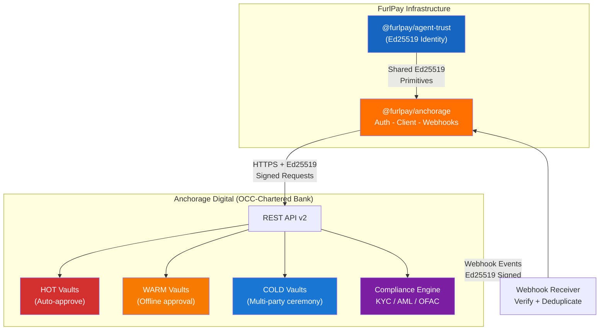
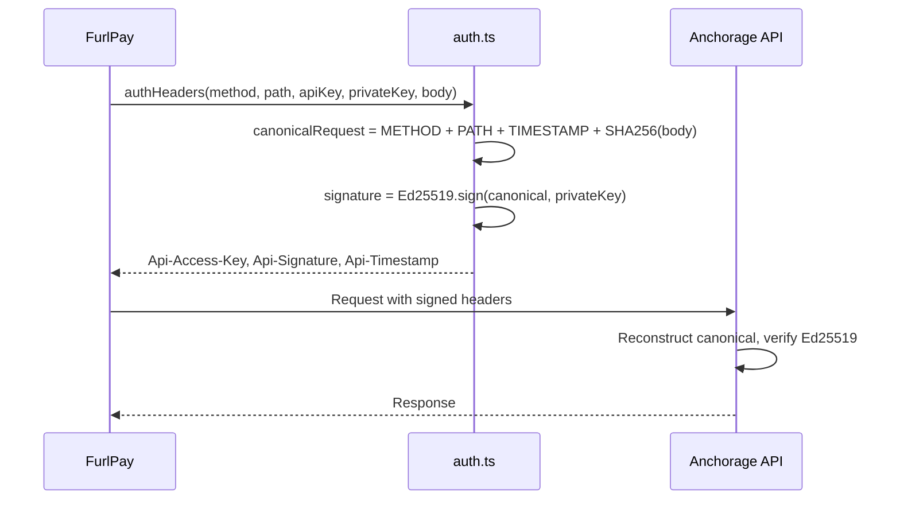

# @furlpay/anchorage

<p align="center">
  
  
  
  
  
  
</p>

> **Anchorage Digital REST API client for institutional custody, vault management, transfers, and compliance.**

> [!IMPORTANT]
> This is a **proposed integration** -- requires Anchorage Digital institutional onboarding. Code is integration-ready but cannot be tested without production credentials.

## Architecture



## Request Authentication Flow



## Features

| Feature | Description |
|:--------|:------------|
| **Ed25519 Request Signing** | Anchorage-compatible authentication: `METHOD\nPATH\nTIMESTAMP\nBODY_HASH` |
| **Vault Management** | List, get, and query balances across HOT/WARM/COLD vaults |
| **Transfers** | Initiate, poll, cancel, and wait for transfer completion |
| **Address Book** | Manage trusted destination addresses |
| **Webhook Verification** | Ed25519 signature verification on incoming events |
| **Event Deduplication** | In-memory deduplicator for idempotent webhook processing |
| **Compliance Queries** | KYC/AML/sanctions/Travel Rule status |
| **Zero Dependencies** | Native `fetch()` + `node:crypto` only |

## Installation

```bash
npm install @furlpay/anchorage
```

## Quick Start

```typescript
import { AnchorageClient } from "@furlpay/anchorage";

const client = AnchorageClient.fromEnv();

// List vaults
const vaults = await client.listVaults();

// Initiate a USDC transfer
const transfer = await client.createTransfer({
  sourceVaultId: "vault-001",
  destinationAddress: "0xRecipient...",
  assetType: "USDC",
  amount: "1000.00",
  network: "ethereum",
  externalId: "furlpay-tx-abc123", // idempotency key
});

// Wait for completion
const result = await client.waitForTransfer(transfer.transferId);
console.log(result.txHash);
```

### Webhook Verification

```typescript
import { verifyWebhook, EventDeduplicator, dispatchWebhook } from "@furlpay/anchorage";

const dedup = new EventDeduplicator();

app.post("/webhooks/anchorage", async (req, res) => {
  const result = verifyWebhook(req.body, req.headers["x-anchorage-signature"], {
    signingPublicKey: process.env.ANCHORAGE_WEBHOOK_PUBLIC_KEY!,
  });

  if (!result.valid) return res.status(401).json({ error: result.reason });
  if (dedup.isDuplicate(result.event!.eventId)) return res.status(200).end();

  await dispatchWebhook(result.event!, {
    TRANSFER_COMPLETED: async (e) => { /* update ledger */ },
    DEPOSIT_DETECTED: async (e) => { /* notify user */ },
  });

  res.status(200).end();
});
```

### Ed25519 Request Signing

```typescript
import { canonicalRequest, signCanonical, verifyCanonical } from "@furlpay/anchorage";

const canonical = canonicalRequest("POST", "/v2/transfers", timestamp, body);
const signature = signCanonical(canonical, ed25519PrivateKeyPem);
const valid = verifyCanonical(canonical, signature, ed25519PublicKeyPem);
```

## Environment Variables

| Variable | Required | Description |
|:---------|:---------|:------------|
| `ANCHORAGE_API_KEY` | Yes | API access key from onboarding |
| `ANCHORAGE_API_SECRET` | Yes | Ed25519 private key (PEM format) |
| `ANCHORAGE_BASE_URL` | Optional | Override API base URL |

## Module Structure

```
packages/anchorage/
├── src/
│   ├── types.ts       # Vault, Transfer, Webhook, Compliance types
│   ├── auth.ts        # Ed25519 request signing protocol
│   ├── client.ts      # REST API client with retry + idempotency
│   └── webhooks.ts    # Webhook verification + event dispatch
├── tests/
│   └── anchorage.test.ts  # 14 tests (node:test)
├── index.ts           # Barrel exports
├── package.json
├── tsconfig.json
└── LICENSE
```

## License

MIT - FurlPay
