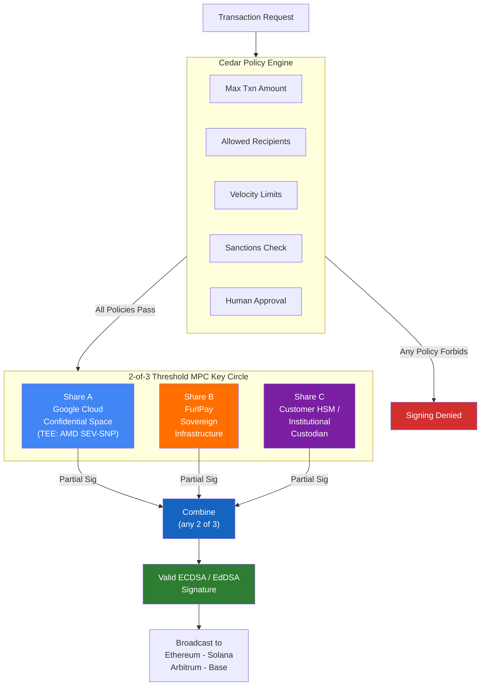
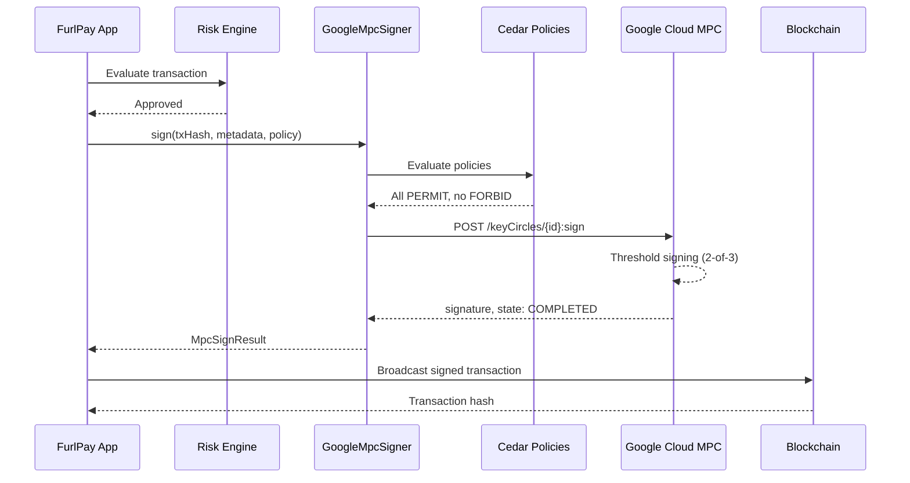

# @furlpay/google-mpc

<p align="center">
  
  
  
  
  
  
  
</p>

> **Google Cloud Multi-Party Compute (MPC) v1beta client for FurlPay's 2-of-3 threshold signing architecture.**

> [!IMPORTANT]
> Google Cloud MPC is in **private preview** (announced Oct 28, 2026). This package is an integration-ready client built from the publicly described API surface. Endpoint paths and schemas may change before GA (early 2027).

## Architecture



The full private key is **never reconstructed**. Each share holder produces a partial signature, and any 2-of-3 partials combine into a valid ECDSA/EdDSA signature indistinguishable from a single-signer output.

## Signing Flow



## Features

| Feature | Description |
|:--------|:------------|
| **Key Circle Management** | Create, list, get, delete key circles with configurable threshold (T-of-N) |
| **Threshold Signing** | Initiate signing operations, poll for completion, wait for async approvals |
| **Cedar Transaction Policies** | Build, validate, and manage Cedar policy rules for transaction authorization |
| **Confidential Space Attestation** | Verify TEE attestation tokens (AMD SEV-SNP / Intel TDX) |
| **Integration Seam** | Drop-in replacement for `@furlpay/security`'s mock MPC signer |
| **Zero Dependencies** | Uses native `fetch()` and `node:crypto` only |

## Installation

```bash
npm install @furlpay/google-mpc
```

## Quick Start

```typescript
import { GoogleMpcSigner } from "@furlpay/google-mpc";

// Auto-configures from environment variables
const signer = GoogleMpcSigner.fromEnv();

// Sign a transaction hash (mock in dev, real MPC in production)
const result = await signer.sign(transactionHash, {
  chain: "ethereum",
  to: "0x...",
  value: "1000000",
  tokenContract: "0xA0b86991c6218b36c1d19D4a2e9Eb0cE3606eB48",
  tokenSymbol: "USDC",
});

console.log(result.signature); // 0x...
console.log(result.cosigned);  // true
console.log(result.shares);    // ["A", "B"]
```

### Cedar Transaction Policies

```typescript
import {
  maxTransactionAmount,
  allowedRecipients,
  velocityLimit,
  sanctionsCheck,
  allowedChains,
} from "@furlpay/google-mpc/cedar";

const policies = [
  maxTransactionAmount(50_000),                    // Forbid txns > $50K
  allowedRecipients(["0xABC...", "0xDEF..."]),     // Only known addresses
  velocityLimit(200_000, 86400),                   // Max $200K/day
  sanctionsCheck(),                                // Block sanctioned addresses
  allowedChains(["ethereum", "solana"]),            // Only these chains
];
```

### Direct API Client

```typescript
import { GoogleMpcClient } from "@furlpay/google-mpc";

const client = new GoogleMpcClient({
  projectId: "my-project",
  location: "us-central1",
  serviceAccountKey: JSON.parse(process.env.GOOGLE_MPC_SERVICE_ACCOUNT_KEY!),
});

// Create a 2-of-3 key circle
const keyCircle = await client.createKeyCircle({
  parent: "projects/my-project/locations/us-central1",
  keyCircleId: "treasury-001",
  displayName: "FurlPay Treasury",
  algorithm: "ECDSA_SECP256K1",
  threshold: 2,
  shareHolders: ["GOOGLE_CLOUD", "CUSTOMER", "CUSTODIAN"],
});

// Sign with policy enforcement
const signResult = await client.sign({
  keyCircleName: keyCircle.name,
  payload: txHash,
  payloadType: "TRANSACTION_HASH",
  chain: "ethereum",
  transactionMetadata: { chain: "ethereum", to: "0x...", value: "0" },
});

const finalResult = await client.waitForSignature(signResult.operationName);
```

## Environment Variables

| Variable | Required | Description |
|:---------|:---------|:------------|
| `GOOGLE_MPC_PROJECT_ID` | Yes (prod) | Google Cloud project ID |
| `GOOGLE_MPC_LOCATION` | Yes (prod) | Google Cloud region (e.g. `us-central1`) |
| `GOOGLE_MPC_KEY_CIRCLE` | Yes (prod) | Key circle resource name for signing |
| `GOOGLE_MPC_SERVICE_ACCOUNT_KEY` | Yes (prod) | Service account key JSON |
| `GOOGLE_MPC_ACCESS_TOKEN` | Optional | Pre-obtained access token (overrides SA key) |
| `GOOGLE_MPC_BASE_URL` | Optional | Override API base URL (testing) |

## Module Structure

```
packages/google-mpc/
├── src/
│   ├── types.ts              # Core type definitions
│   ├── client.ts             # Google MPC REST API client
│   ├── cedar.ts              # Cedar policy builder helpers
│   ├── confidential-space.ts # TEE attestation verification
│   └── seam.ts               # Drop-in replacement for mock MPC
├── tests/
│   └── google-mpc.test.ts    # 20 tests (node:test)
├── index.ts                  # Barrel exports
├── package.json
├── tsconfig.json
└── LICENSE
```

## License

MIT - FurlPay
