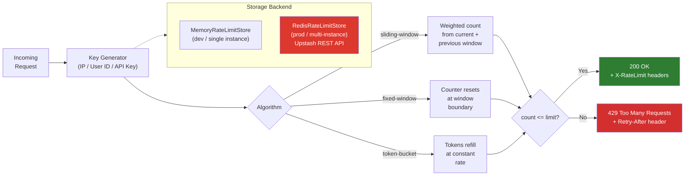
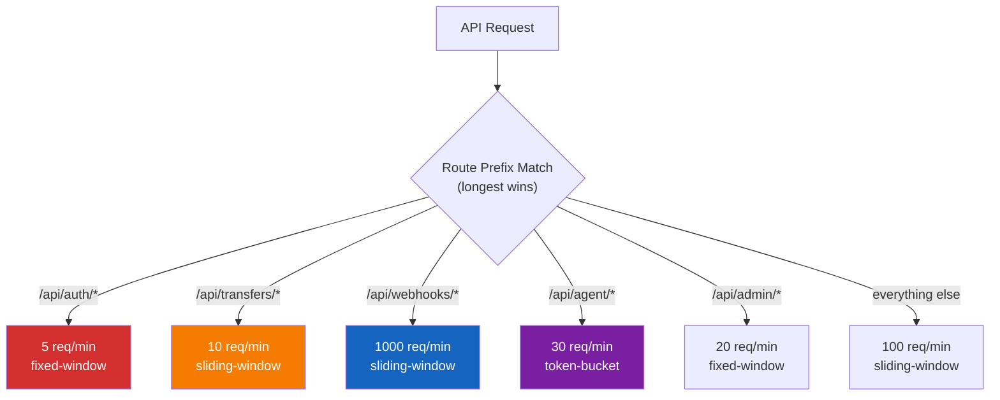

# @furlpay/rate-limit

<p align="center">
  
  
  
  
  
  
</p>

> **Production-grade rate limiting for FurlPay's 295 API routes -- sliding window, fixed window, and token bucket algorithms with in-memory and Redis stores.**

## Why This Exists

FurlPay has **295 Next.js API routes** with zero rate limiting. This package provides:

- **DDoS protection** -- prevent resource exhaustion
- **Brute-force defense** -- strict limits on auth endpoints (5 req/min)
- **Payment safety** -- throttle financial endpoints (10 req/min)
- **Bot management** -- per-agent rate limits
- **Standard headers** -- `X-RateLimit-*` and `Retry-After`

## Architecture



## Route-Level Rate Limiting



## Features

| Feature | Description |
|:--------|:------------|
| **Three Algorithms** | Sliding window, fixed window, token bucket |
| **In-Memory Store** | Zero-config development store with auto-cleanup |
| **Redis Store** | Upstash REST API (Edge-compatible, no TCP) |
| **Route-Specific Limits** | Different limits per API path prefix |
| **Presets** | Pre-tuned configs for auth, payment, webhook, agent endpoints |
| **Skip Rules** | Exempt health checks, webhooks, internal calls |
| **Custom Key Generators** | Rate limit by IP, user ID, API key, or custom logic |
| **429 Response Builder** | Standards-compliant JSON error with headers |
| **Zero Dependencies** | Native `fetch()` for Redis, no external packages |

## Installation

```bash
npm install @furlpay/rate-limit
```

## Quick Start

```typescript
import { rateLimit, rateLimitResponse, rateLimitHeaders, PRESETS } from "@furlpay/rate-limit";

const limiter = rateLimit(PRESETS.api); // 100 req/min, sliding window

const result = await limiter({
  ip: request.headers.get("x-forwarded-for") ?? "unknown",
  path: new URL(request.url).pathname,
  method: request.method,
  headers: Object.fromEntries(request.headers),
});

if (!result.allowed) {
  return rateLimitResponse(result.info); // 429 with Retry-After
}

const headers = rateLimitHeaders(result.info);
```

### Route-Specific Rate Limiting

```typescript
import { routeRateLimit, FURLPAY_ROUTE_LIMITS, PRESETS } from "@furlpay/rate-limit";

const limiter = routeRateLimit(FURLPAY_ROUTE_LIMITS, PRESETS.api);
```

### With Redis (Production)

```typescript
import { rateLimit, PRESETS } from "@furlpay/rate-limit";
import { RedisRateLimitStore } from "@furlpay/rate-limit/redis";

const store = new RedisRateLimitStore({
  url: process.env.UPSTASH_REDIS_REST_URL!,
  token: process.env.UPSTASH_REDIS_REST_TOKEN!,
});

const limiter = rateLimit(PRESETS.payment, store);
```

### Next.js Middleware Integration

```typescript
// middleware.ts
import { routeRateLimit, rateLimitHeaders, FURLPAY_ROUTE_LIMITS, PRESETS } from "@furlpay/rate-limit";

const limiter = routeRateLimit(FURLPAY_ROUTE_LIMITS, PRESETS.api);

export async function middleware(request: NextRequest) {
  const result = await limiter({
    ip: request.ip ?? request.headers.get("x-forwarded-for") ?? "unknown",
    path: request.nextUrl.pathname,
    method: request.method,
    headers: Object.fromEntries(request.headers),
  });

  if (!result.allowed) {
    return new NextResponse(JSON.stringify({ error: "Too Many Requests" }), {
      status: 429,
      headers: rateLimitHeaders(result.info),
    });
  }

  const response = NextResponse.next();
  for (const [k, v] of Object.entries(rateLimitHeaders(result.info))) {
    response.headers.set(k, v);
  }
  return response;
}
```

## Presets

| Preset | Limit | Window | Algorithm | Use Case |
|:-------|:------|:-------|:----------|:---------|
| `api` | 100/min | 60s | sliding-window | General API endpoints |
| `auth` | 5/min | 60s | fixed-window | Login, register, OTP |
| `payment` | 10/min | 60s | sliding-window | Transfers, payments |
| `webhook` | 1000/min | 60s | sliding-window | Incoming webhooks |
| `publicRead` | 200/min | 60s | sliding-window | Prices, status checks |
| `agent` | 30/min | 60s | token-bucket | AI agent API calls |
| `admin` | 20/min | 60s | fixed-window | Admin operations |

## Failure Modes

| Store | On Error | Rationale |
|:------|:---------|:----------|
| **Memory** | N/A (in-process) | Cannot fail independently |
| **Redis** | **Fail open** (allow request) | Blocking all API traffic on a Redis outage is worse than briefly allowing extra requests |

> [!NOTE]
> This is the opposite of `@furlpay/agent-trust/redis` which **fails closed** -- nonce/budget stores guard financial authorization, where failing open means accepting replayed tokens.

## Module Structure

```
packages/rate-limit/
├── src/
│   ├── types.ts                  # Core interfaces
│   ├── middleware.ts             # Rate limiter + HTTP helpers
│   ├── presets.ts                # Pre-tuned configurations
│   └── stores/
│       ├── memory.ts             # In-memory store (dev/single-instance)
│       └── redis.ts              # Upstash Redis store (production)
├── tests/
│   └── rate-limit.test.ts        # 14 tests (node:test)
├── index.ts                      # Barrel exports
├── package.json
├── tsconfig.json
└── LICENSE
```

## License

MIT - FurlPay
